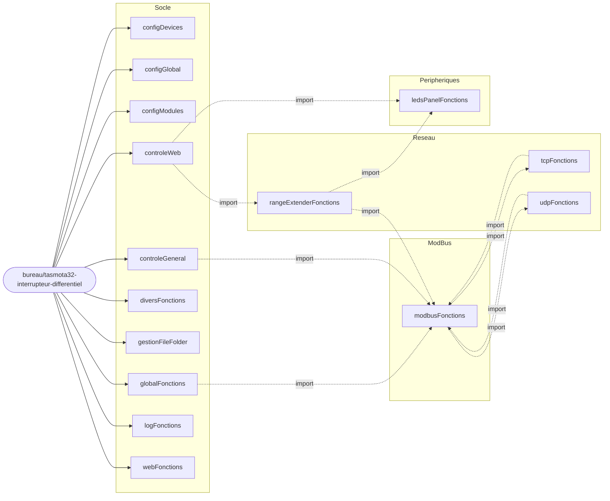
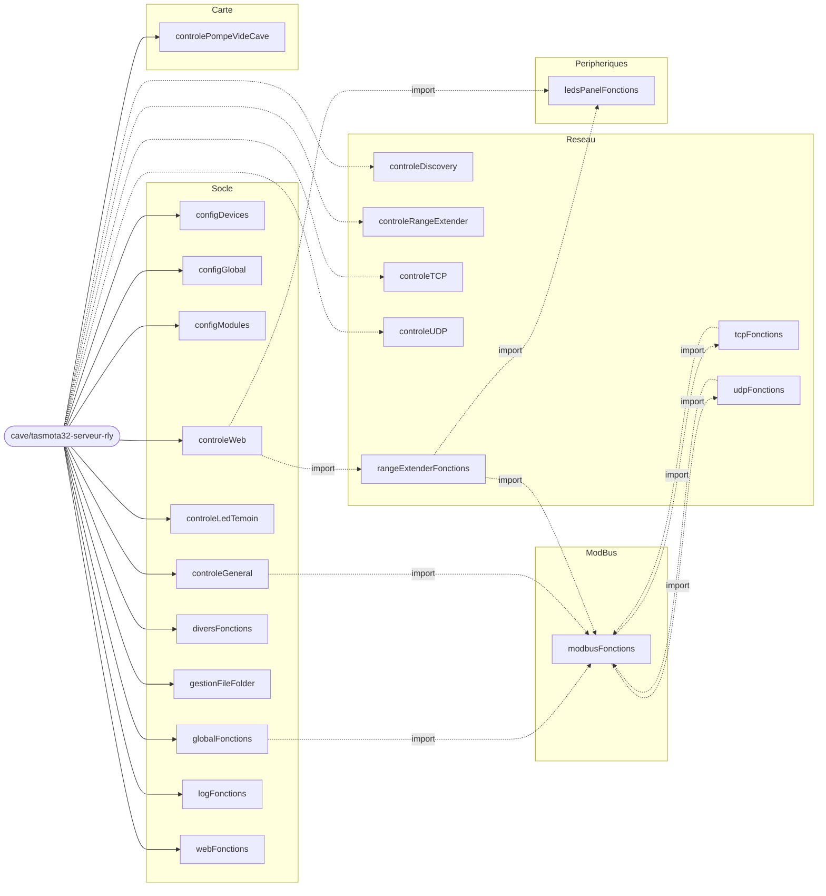
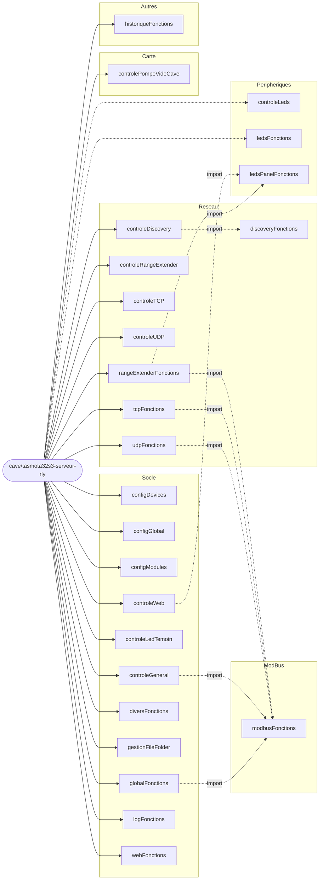
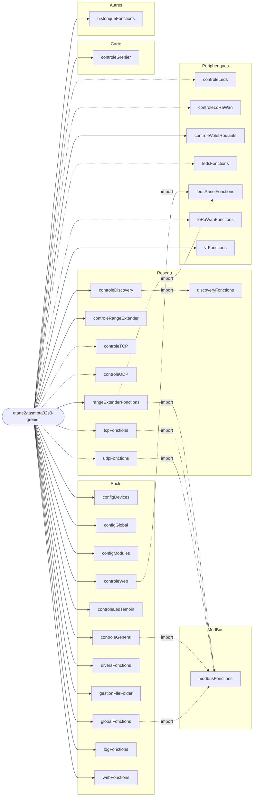
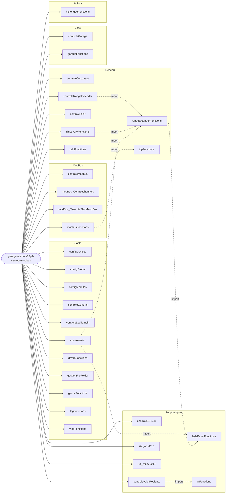
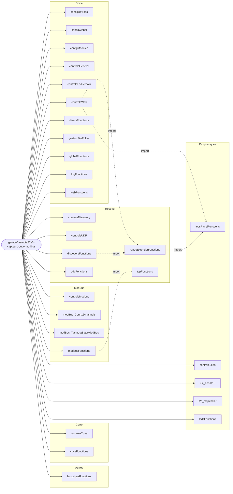
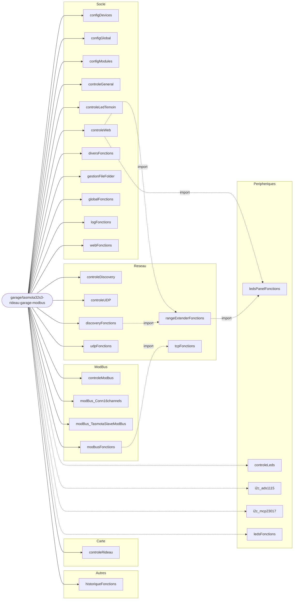

# Carte des modules Berry par carte

> Fichier GENERE par carte_modules_berry.py - ne pas editer a la main.
> Genere le 2026-10-13 20:34.

41 modules (34 dans `data/fs`, 7 propres a une carte), 8 cartes.

## Tableau

Legende : **S** solidifie dans l'env (`custom_berry_solidify`) - **I** importe par l'autoexec - **C** `compileModule` / `loadBerryFile` - **D** charge indirectement (importe par un module charge sur la carte) - **#** reference seulement commentee - **P** fichier propre a la carte - puis la garde d'activation evaluee sur le `_persist.json` de la carte : **ON** / **OFF** / **?** (non evaluable). Pas d'etat = pas de garde. Cellule vide = rien.

| Module | Famille | bureau<br>tasmota32-interrupteur-differentiel | cave<br>tasmota32-serveur-rly | cave<br>tasmota32s3-serveur-rly | etage2<br>tasmota32s3-grenier | garage<br>tasmota32p4-serveur-modbus | garage<br>tasmota32s3-capteurs-cuve-modbus | garage<br>tasmota32s3-rideau-garage-modbus | garage<br>tasmota32s3-serveur-modbus |
|---|---|---|---|---|---|---|---|---|---|
| `configDevices` | Socle | S C ON | S C ON | S C ON | S C ON | S C ON | S C ON | S C ON | S C ON |
| `configGlobal` | Socle | S I C ON | S I C ON | S I C ON | S I C ON | S I C ON | S I C ON | S I C ON | S I C ON |
| `configModules` | Socle | S C ON | S C ON | S C ON | S C ON | S C ON | S C ON | S C ON | S C ON |
| `controleGeneral` | Socle | S I | S I | S I | S I | S I | S I | S I | S I |
| `controleLedTemoin` | Socle | S | S I | S I | S I | S I | S I | S I | S I |
| `controleWeb` | Socle | S I | S I | S I | S I | S I | S I | S I | S I |
| `diversFonctions` | Socle | S I C ON | S I C ON | S I C ON | S I C ON | S I C ON | S I C ON | S I C ON | S I C ON |
| `gestionFileFolder` | Socle | S I C ON | S I C ON | S I C ON | S I C ON | S I C ON | S I C ON | S I C ON | S I C ON |
| `globalFonctions` | Socle | S I C ON | S I C ON | S I C ON | S I C ON | S I C ON | S I C ON | S I C ON | S I C ON |
| `logFonctions` | Socle | S I C ON | S I C ON | S I C ON | S I C ON | S I C ON | S I C ON | S I C ON | S I C ON |
| `webFonctions` | Socle | S I C ON | S I C ON | S I C ON | S I C ON | S I C ON | S I C ON | S I C ON | S I C ON |
| `controleDiscovery` | Reseau | S # | S I OFF | S I ON | S I ON | S I ON | S I ON | S I ON | S I ON |
| `controleRangeExtender` | Reseau | S # | S I OFF | S I ON | S I ON | S I ON | S # | S # | S I ON |
| `controleTCP` | Reseau | S | S I OFF | S I ON | S I OFF | S # | S # | S # | S I ON |
| `controleUDP` | Reseau | S # | S I OFF | S I ON | S I OFF | S I ON | S I ON | S I ON | S I ON |
| `discoveryFonctions` | Reseau | S # | S | S D | S D | S C ON | S C ON | S C ON | S C ON |
| `rangeExtenderFonctions` | Reseau | S D | S D C OFF | S C ON | S C ON | S D | S D | S D | S C ON |
| `tcpFonctions` | Reseau | S D | S D C OFF | S C ON | S C OFF | S D | S D | S D | S C ON |
| `udpFonctions` | Reseau | S D | S D C OFF | S C ON | S C OFF | S C ON | S C ON | S C ON | S C ON |
| `controleModbus` | ModBus | # | # | # | # | S I ON | S I ON | S I ON | S I ON |
| `modBus_Conn16channels` | ModBus |  | # | # | # | S I ON | S I ON | S I ON | S I ON |
| `modBus_TasmotaSlaveModBus` | ModBus |  | # | # | # | S I ON | S I ON | S I ON | S I ON |
| `modbusFonctions` | ModBus | D | D | D | D | S I | S I | S I | S I C ON |
| `controleES8311` | Peripheriques |  |  |  |  | S I ON |  |  |  |
| `controleLeds` | Peripheriques |  |  | C OFF | C OFF |  | C ON | C OFF | C OFF |
| `controleLoRaWan` | Peripheriques | # | # | # | S I OFF | # | # | # | S I ON |
| `controleVoletRoulants` | Peripheriques | # | # | # | S I ON | S I ON | # | # | S I OFF |
| `i2c_ads1115` | Peripheriques | # | # | # | # | S I ON | S I ON | S I OFF | S I ON |
| `i2c_mcp23017` | Peripheriques | # | # | # | # | S I ON | S I ON | S I OFF | S I ON |
| `ledsFonctions` | Peripheriques |  |  | C OFF | C OFF |  | C ON | C OFF | C OFF |
| `ledsPanelFonctions` | Peripheriques | S D | S D | S D | S D | S D | S D | S D | S D |
| `loRaWanFonctions` | Peripheriques | # | # | # | S C OFF | # | # | # | S C ON |
| `vrFonctions` | Peripheriques | # | # | # | S C | S D | # | # | S C OFF |
| `controleCuve` | Carte |  |  |  |  |  | P C ON |  |  |
| `controleGarage` | Carte | # |  |  |  | P C ON |  |  | P C ON |
| `controleGrenier` | Carte |  | # | # | P C ON |  |  |  |  |
| `controlePompeVideCave` | Carte |  | P C ON | P C ON |  |  |  |  |  |
| `controleRideau` | Carte |  |  |  |  |  |  | P C ON |  |
| `cuveFonctions` | Carte |  |  |  |  |  | P C ON |  |  |
| `garageFonctions` | Carte | # |  |  |  | P C ON |  |  | P C ON |
| `historiqueFonctions` | Autres |  |  | I C ON | I C ON | I C ON | I C ON | I C ON | I C ON |

Envs : `bureau/tasmota32-interrupteur-differentiel` = `tasmota32-bureau-interrupteur-differentiel` ; `cave/tasmota32-serveur-rly` = `tasmota32-cave-serveur-rly` ; `cave/tasmota32s3-serveur-rly` = `tasmota32s3-cave-serveur-rly` ; `etage2/tasmota32s3-grenier` = `tasmota32s3-etage2-grenier` ; `garage/tasmota32p4-serveur-modbus` = `tasmota32p4-garage-serveur-modbus` ; `garage/tasmota32s3-capteurs-cuve-modbus` = `tasmota32s3-garage-capteurs-cuve-modbus` ; `garage/tasmota32s3-rideau-garage-modbus` = `tasmota32s3-garage-rideau-garage-modbus` ; `garage/tasmota32s3-serveur-modbus` = `tasmota32s3-garage-serveur-modbus`

## Incoherences detectees

Constats factuels, sans jugement : un module peut etre volontairement dans cet etat.

- `bureau/tasmota32-interrupteur-differentiel` : `controleLedTemoin` solidifie, jamais importe ni charge par l'autoexec.
- `bureau/tasmota32-interrupteur-differentiel` : `controleDiscovery` solidifie, reference seulement en commentaire dans l'autoexec.
- `bureau/tasmota32-interrupteur-differentiel` : `controleRangeExtender` solidifie, reference seulement en commentaire dans l'autoexec.
- `bureau/tasmota32-interrupteur-differentiel` : `controleTCP` solidifie, jamais importe ni charge par l'autoexec.
- `bureau/tasmota32-interrupteur-differentiel` : `controleUDP` solidifie, reference seulement en commentaire dans l'autoexec.
- `bureau/tasmota32-interrupteur-differentiel` : `discoveryFonctions` solidifie, reference seulement en commentaire dans l'autoexec.
- `cave/tasmota32-serveur-rly` : `discoveryFonctions` solidifie, jamais importe ni charge par l'autoexec.
- `garage/tasmota32p4-serveur-modbus` : `controleTCP` solidifie, reference seulement en commentaire dans l'autoexec.
- `garage/tasmota32s3-capteurs-cuve-modbus` : `controleRangeExtender` solidifie, reference seulement en commentaire dans l'autoexec.
- `garage/tasmota32s3-capteurs-cuve-modbus` : `controleTCP` solidifie, reference seulement en commentaire dans l'autoexec.
- `garage/tasmota32s3-rideau-garage-modbus` : `controleRangeExtender` solidifie, reference seulement en commentaire dans l'autoexec.
- `garage/tasmota32s3-rideau-garage-modbus` : `controleTCP` solidifie, reference seulement en commentaire dans l'autoexec.
- `data/etage2/tasmota32s3-grenier/controleGrenier.be` : fichier vide.

### Informations (normal ou voulu, listees pour memoire)

- `cave/tasmota32-serveur-rly` : `controleDiscovery` : import / chargement conditionne par l'autoexec, condition evaluee OFF (non execute).
- `cave/tasmota32-serveur-rly` : `controleRangeExtender` : import / chargement conditionne par l'autoexec, condition evaluee OFF (non execute).
- `cave/tasmota32-serveur-rly` : `controleTCP` : import / chargement conditionne par l'autoexec, condition evaluee OFF (non execute).
- `cave/tasmota32-serveur-rly` : `controleUDP` : import / chargement conditionne par l'autoexec, condition evaluee OFF (non execute).
- `cave/tasmota32-serveur-rly` : `rangeExtenderFonctions` : charge alors que sa garde vaut OFF.
- `cave/tasmota32-serveur-rly` : `tcpFonctions` : charge alors que sa garde vaut OFF.
- `cave/tasmota32-serveur-rly` : `udpFonctions` : charge alors que sa garde vaut OFF.
- `cave/tasmota32s3-serveur-rly` : `controleLeds` charge depuis `data/fs` sans etre solidifie (copie sur le FS, compile au demarrage).
- `cave/tasmota32s3-serveur-rly` : `controleLeds` : import / chargement conditionne par l'autoexec, condition evaluee OFF (non execute).
- `cave/tasmota32s3-serveur-rly` : `ledsFonctions` charge depuis `data/fs` sans etre solidifie (copie sur le FS, compile au demarrage).
- `cave/tasmota32s3-serveur-rly` : `ledsFonctions` : import / chargement conditionne par l'autoexec, condition evaluee OFF (non execute).
- `cave/tasmota32s3-serveur-rly` : `historiqueFonctions` charge depuis `data/fs` sans etre solidifie (copie sur le FS, compile au demarrage).
- `etage2/tasmota32s3-grenier` : `controleTCP` : charge alors que sa garde vaut OFF.
- `etage2/tasmota32s3-grenier` : `controleUDP` : charge alors que sa garde vaut OFF.
- `etage2/tasmota32s3-grenier` : `tcpFonctions` : charge alors que sa garde vaut OFF.
- `etage2/tasmota32s3-grenier` : `udpFonctions` : charge alors que sa garde vaut OFF.
- `etage2/tasmota32s3-grenier` : `controleLeds` charge depuis `data/fs` sans etre solidifie (copie sur le FS, compile au demarrage).
- `etage2/tasmota32s3-grenier` : `controleLeds` : import / chargement conditionne par l'autoexec, condition evaluee OFF (non execute).
- `etage2/tasmota32s3-grenier` : `controleLoRaWan` : charge alors que sa garde vaut OFF.
- `etage2/tasmota32s3-grenier` : `ledsFonctions` charge depuis `data/fs` sans etre solidifie (copie sur le FS, compile au demarrage).
- `etage2/tasmota32s3-grenier` : `ledsFonctions` : import / chargement conditionne par l'autoexec, condition evaluee OFF (non execute).
- `etage2/tasmota32s3-grenier` : `loRaWanFonctions` : charge alors que sa garde vaut OFF.
- `etage2/tasmota32s3-grenier` : `historiqueFonctions` charge depuis `data/fs` sans etre solidifie (copie sur le FS, compile au demarrage).
- `garage/tasmota32p4-serveur-modbus` : `historiqueFonctions` charge depuis `data/fs` sans etre solidifie (copie sur le FS, compile au demarrage).
- `garage/tasmota32s3-capteurs-cuve-modbus` : `controleLeds` charge depuis `data/fs` sans etre solidifie (copie sur le FS, compile au demarrage).
- `garage/tasmota32s3-capteurs-cuve-modbus` : `ledsFonctions` charge depuis `data/fs` sans etre solidifie (copie sur le FS, compile au demarrage).
- `garage/tasmota32s3-capteurs-cuve-modbus` : `historiqueFonctions` charge depuis `data/fs` sans etre solidifie (copie sur le FS, compile au demarrage).
- `garage/tasmota32s3-rideau-garage-modbus` : `controleLeds` charge depuis `data/fs` sans etre solidifie (copie sur le FS, compile au demarrage).
- `garage/tasmota32s3-rideau-garage-modbus` : `controleLeds` : import / chargement conditionne par l'autoexec, condition evaluee OFF (non execute).
- `garage/tasmota32s3-rideau-garage-modbus` : `i2c_ads1115` : charge alors que sa garde vaut OFF.
- `garage/tasmota32s3-rideau-garage-modbus` : `i2c_mcp23017` : charge alors que sa garde vaut OFF.
- `garage/tasmota32s3-rideau-garage-modbus` : `ledsFonctions` charge depuis `data/fs` sans etre solidifie (copie sur le FS, compile au demarrage).
- `garage/tasmota32s3-rideau-garage-modbus` : `ledsFonctions` : import / chargement conditionne par l'autoexec, condition evaluee OFF (non execute).
- `garage/tasmota32s3-rideau-garage-modbus` : `historiqueFonctions` charge depuis `data/fs` sans etre solidifie (copie sur le FS, compile au demarrage).
- `garage/tasmota32s3-serveur-modbus` : `controleLeds` charge depuis `data/fs` sans etre solidifie (copie sur le FS, compile au demarrage).
- `garage/tasmota32s3-serveur-modbus` : `controleLeds` : import / chargement conditionne par l'autoexec, condition evaluee OFF (non execute).
- `garage/tasmota32s3-serveur-modbus` : `controleVoletRoulants` : charge alors que sa garde vaut OFF.
- `garage/tasmota32s3-serveur-modbus` : `ledsFonctions` charge depuis `data/fs` sans etre solidifie (copie sur le FS, compile au demarrage).
- `garage/tasmota32s3-serveur-modbus` : `ledsFonctions` : import / chargement conditionne par l'autoexec, condition evaluee OFF (non execute).
- `garage/tasmota32s3-serveur-modbus` : `vrFonctions` : charge alors que sa garde vaut OFF.
- `garage/tasmota32s3-serveur-modbus` : `historiqueFonctions` charge depuis `data/fs` sans etre solidifie (copie sur le FS, compile au demarrage).

## Diagrammes

Un diagramme par carte (tout dans un seul serait illisible). Modules **charges** par l'autoexec (import / compileModule / loadBerryFile non commentes). Fleche pleine = garde ON ou sans garde ; pointillee = garde OFF ou non evaluable (?).

### bureau/tasmota32-interrupteur-differentiel



### cave/tasmota32-serveur-rly



### cave/tasmota32s3-serveur-rly



### etage2/tasmota32s3-grenier



### garage/tasmota32p4-serveur-modbus



### garage/tasmota32s3-capteurs-cuve-modbus



### garage/tasmota32s3-rideau-garage-modbus



### garage/tasmota32s3-serveur-modbus

```mermaid
flowchart LR
    CARTE(["garage/tasmota32s3-serveur-modbus"])
    subgraph g_Socle["Socle"]
        m_configDevices["configDevices"]
        m_configGlobal["configGlobal"]
        m_configModules["configModules"]
        m_controleGeneral["controleGeneral"]
        m_controleLedTemoin["controleLedTemoin"]
        m_controleWeb["controleWeb"]
        m_diversFonctions["diversFonctions"]
        m_gestionFileFolder["gestionFileFolder"]
        m_globalFonctions["globalFonctions"]
        m_logFonctions["logFonctions"]
        m_webFonctions["webFonctions"]
    end
    subgraph g_Reseau["Reseau"]
        m_controleDiscovery["controleDiscovery"]
        m_controleRangeExtender["controleRangeExtender"]
        m_controleTCP["controleTCP"]
        m_controleUDP["controleUDP"]
        m_discoveryFonctions["discoveryFonctions"]
        m_rangeExtenderFonctions["rangeExtenderFonctions"]
        m_tcpFonctions["tcpFonctions"]
        m_udpFonctions["udpFonctions"]
    end
    subgraph g_ModBus["ModBus"]
        m_controleModbus["controleModbus"]
        m_modBus_Conn16channels["modBus_Conn16channels"]
        m_modBus_TasmotaSlaveModBus["modBus_TasmotaSlaveModBus"]
        m_modbusFonctions["modbusFonctions"]
    end
    subgraph g_Peripheriques["Peripheriques"]
        m_controleLeds["controleLeds"]
        m_controleLoRaWan["controleLoRaWan"]
        m_controleVoletRoulants["controleVoletRoulants"]
        m_i2c_ads1115["i2c_ads1115"]
        m_i2c_mcp23017["i2c_mcp23017"]
        m_ledsFonctions["ledsFonctions"]
        m_ledsPanelFonctions["ledsPanelFonctions"]
        m_loRaWanFonctions["loRaWanFonctions"]
        m_vrFonctions["vrFonctions"]
    end
    subgraph g_Carte["Carte"]
        m_controleGarage["controleGarage"]
        m_garageFonctions["garageFonctions"]
    end
    subgraph g_Autres["Autres"]
        m_historiqueFonctions["historiqueFonctions"]
    end
    CARTE --> m_configDevices
    CARTE --> m_configGlobal
    CARTE --> m_configModules
    CARTE --> m_controleGeneral
    CARTE --> m_controleLedTemoin
    CARTE --> m_controleWeb
    CARTE --> m_diversFonctions
    CARTE --> m_gestionFileFolder
    CARTE --> m_globalFonctions
    CARTE --> m_logFonctions
    CARTE --> m_webFonctions
    CARTE --> m_controleDiscovery
    CARTE --> m_controleRangeExtender
    CARTE --> m_controleTCP
    CARTE --> m_controleUDP
    CARTE --> m_discoveryFonctions
    CARTE --> m_rangeExtenderFonctions
    CARTE --> m_tcpFonctions
    CARTE --> m_udpFonctions
    CARTE --> m_controleModbus
    CARTE --> m_modBus_Conn16channels
    CARTE --> m_modBus_TasmotaSlaveModBus
    CARTE --> m_modbusFonctions
    CARTE -.-> m_controleLeds
    CARTE --> m_controleLoRaWan
    CARTE -.-> m_controleVoletRoulants
    CARTE --> m_i2c_ads1115
    CARTE --> m_i2c_mcp23017
    CARTE -.-> m_ledsFonctions
    m_rangeExtenderFonctions -.->|import| m_ledsPanelFonctions
    m_controleWeb -.->|import| m_ledsPanelFonctions
    CARTE --> m_loRaWanFonctions
    CARTE -.-> m_vrFonctions
    CARTE --> m_controleGarage
    CARTE --> m_garageFonctions
    CARTE --> m_historiqueFonctions
```



## Comment regenerer

```
python outils_docs/scripts_python/berry/carte_modules_berry.py
```

Lecture seule : aucun build, aucune ecriture sous `data/`. La config PlatformIO est lue par l'API `ProjectConfig` dans le Python de PlatformIO (`~/.platformio/penv`).
