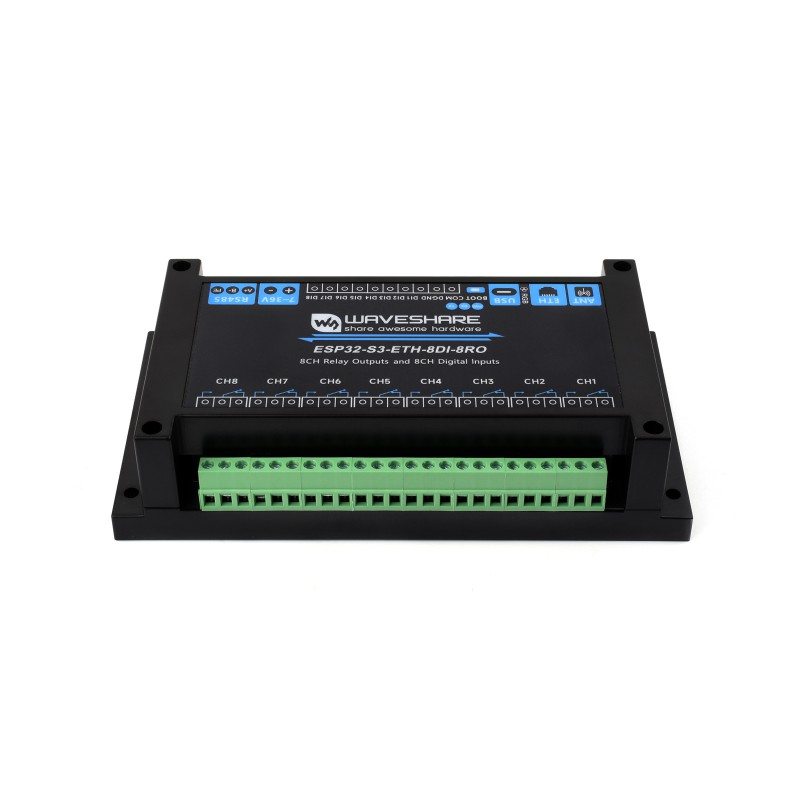
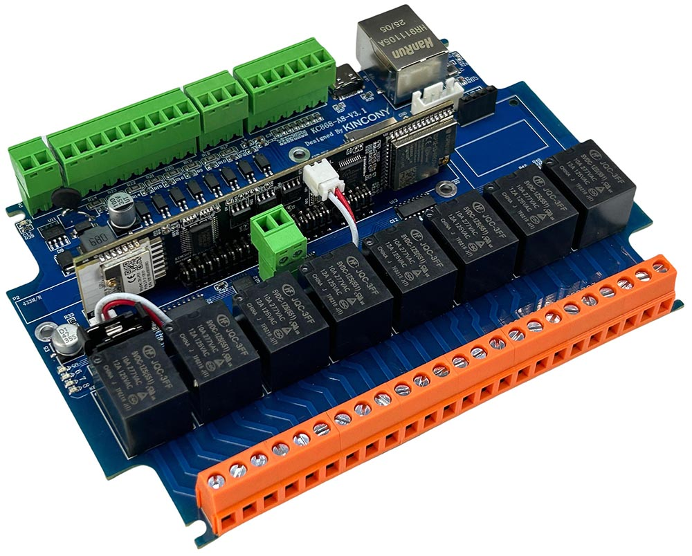
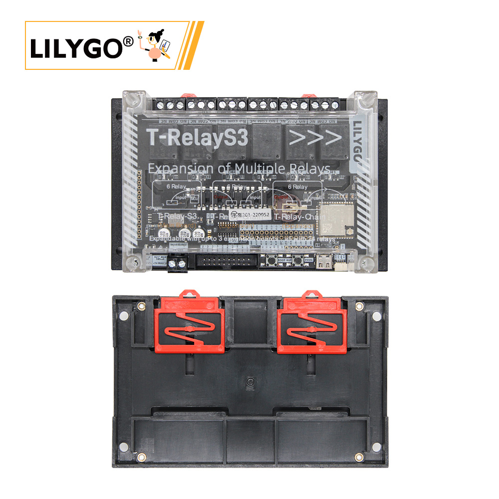

# Cartes 8 relais ESP32-S3 pour remplacer la carte relais de la cave

Recherche du 2026-10-31 (aucune carte n'a été achetée ni testée : tout vient des fiches fabricant, des wikis et de pages ESPHome/blakadder).

**Carte à remplacer** : carte AliExpress générique « ESP32 Relay x8 » (ESP32-WROOM, ESP32-D0WD-V3, 4 Mo, sans PSRAM), alimentée en DC 7-30 V. Raison du remplacement : le firmware (Tasmota 32 + Berry) manque de RAM sans PSRAM.
Usage : 5 relais utilisés sur 8 (pompe vide-cave, ventilation, LED machines, pompe cuve, lavage), 3 boutons, 2 capteurs de niveau (contacts secs), 1 AM2301 (1 fil, GPIO bidirectionnelle libre), 1 LED témoin.

## Critères

1. ESP32-S3 avec PSRAM (N16R8 de préférence, N8R8/N8R2 acceptable).
2. 8 relais, 10 A minimum.
3. Alimentation DC couvrant 7-30 V (ou au moins 12 et 24 V) : **obligatoire**.
4. Entrées pour 3 boutons + 2 capteurs de niveau + AM2301 (entrées optocouplées utilisables, ou GPIO libres ; l'AM2301 exige une GPIO bidirectionnelle libre).
5. Pilotage des relais : GPIO direct ou expandeur I2C ; si expandeur, un driver Tasmota doit exister dans le dépôt, sinon « incompatible sans développement ».
6. Fixation et encombrement, comparés à la carte actuelle.
7. Prix et disponibilité en France / UE (consultation 2026-10-31).

Référence d'encombrement : la fiche d'une carte « ESP32 Relay x8 » classique ([emariete](https://emariete.com/en/esp32-relay-board-x8/)) **ne donne pas ses dimensions** ; le « 140 x 125 mm » de la consigne n'est donc pas vérifié (non trouvé). Cette fiche confirme 7-30 V DC et relais 10 A (sérigraphie).

## Tableau comparatif

| Lettre | Carte | Puce / PSRAM | Relais | Alimentation | Entrées / GPIO libres | Pilotage relais + driver Tasmota | Dimensions / fixation | Prix (2026-10-31) |
|---|---|---|---|---|---|---|---|---|
| **A** | Waveshare ESP32-S3-ETH-8DI-8RO (RS485) | ESP32-S3-WROOM-1U **N16R8** (16 Mo / 8 Mo PSRAM) | 8, 10 A 250 V AC / 30 V DC, 1 NO + 1 NC | **7-36 V DC** (ou USB-C 5 V) | 8 DI optocouplées 5-36 V (GPIO4-11) ; en-tête 28 broches avec GPIO21 visible | **TCA9554PWR** (I2C 0x20) -> `xdrv_69_pca9557.ino` (`USE_TCA9554`) : **compatible** | 175 x 90 x 40 mm, boîtier ABS rail DIN 35 mm | 47,32 EUR TTC (elty.pl, rupture) ; 54,95 EUR (OpenELab, solde) ; 39-43 EUR sur waveshare.com converti (non confirmé TTC/port) |
| **B** | Waveshare ESP32-S3-ETH-8DI-8RO-C (CAN isolé au lieu de RS485) | idem A (N16R8) | idem A | 7-36 V DC | idem A | idem A (TCA9554, 0x20) | idem A | non trouvé en EUR ; revendeur OpenELab (lien non vérifiable par curl) |
| **C** | KinCony KC868-A8v3 | ESP32-S3-WROOM-1U **N16R8** | 8, 10 A 250 V (JQC-3FF visibles sur la photo) | **12/24 V DC** | 8 DI optocouplées (via expandeur) + **4 GPIO 1-Wire avec pull-up** (GPIO13, 40, 14, 48 d'après ESPHome) | **PCF8575** (I2C 0x22, d'après ESPHome) -> **aucun driver Tasmota** (`pcf8575` absent du dépôt ; `xdrv_28_pcf8574_v2.ino` = PCF8574 8 bits) : **incompatible sans développement** | PCB 105 x 148 mm ; rail DIN avec coque plastique | 80 USD (KinCony, épuisé à la capture) ; prix UE non trouvé |
| **D** | LilyGO T-Relay S3 | ESP32-S3, 16 Mo flash / 8 Mo PSRAM | **6 seulement : HORS CRITÈRE** | non trouvé | GPIO en image uniquement | 74HC595 -> `xdrv_60_shift595.ino` (driver existe) | rail DIN (photo) ; dimensions non trouvées | non trouvé |

## Fiches

### A — Waveshare ESP32-S3-ETH-8DI-8RO (recommandée)

- Fabricant : <https://www.waveshare.com/esp32-s3-eth-8di-8ro.htm> (44,99-49,99 USD)
- Wiki : <https://www.waveshare.com/wiki/ESP32-S3-ETH-8DI-8RO>
- ESPHome (brochage) : <https://devices.esphome.io/devices/Waveshare-ESP32-S3-ETH-8DI-8RO>
- Modèle Tasmota (variante PoE, même brochage relais) : <https://templates.blakadder.com/waveshare_ESP32-S3-POE-ETH-8DI-8RO.html>
- Vendeurs UE : [elty.pl](https://elty.pl/en_US/p/8-Channel-Relay-Module-with-ESP32-S3-WiFi-Ethernet-W5500-and-RS485/3980) (Pologne, 47,32 EUR TTC, **hors stock**), [OpenELab FR](https://openelab.io/fr/products/waveshare-industrial-8-channel-esp32-s3-wifi-relay-eth-8di-8ro-module-rs485) (54,95 EUR, entrepôt Chine d'après la version anglaise), [The Pi Hut](https://thepihut.com/products/8-channel-esp32-s3-wifi-relay-module-with-rs485-poe-option) (Royaume-Uni, hors UE : 43,20 GBP TTC).

Brochage utile (wiki + ESPHome) : DI1-8 = GPIO4-11 ; bus I2C GPIO41 (SCL) / GPIO42 (SDA) ; RS485 GPIO17/18 ; W5500 GPIO12-16 ; WS2812 GPIO38 ; buzzer GPIO46 ; carte TF GPIO45/47/48 ; BOOT GPIO0.
Le dépôt contient la configuration de cette carte en commentaire de `tasmota/tasmota_xdrv_driver/xdrv_69_pca9557.ino` : `{"NAME":"TCA9554","GPIO":[224,225,226,227,228,229,230,231]}`. Il faut compiler avec `USE_TCA9554` (commenté dans `tasmota/my_user_config.h`, à activer dans l'env).

Adéquation : 5 DI optocouplées couvrent 3 boutons + 2 capteurs de niveau (3 DI restent libres) ; la LED témoin peut être la LED WS2812 (GPIO38) ou le buzzer. **L'AM2301 (DHT22)** : la sérigraphie de l'en-tête GPIO (repère 14 de l'image `ESP32-S3-ETH-8DI-8RO-details-inter.jpg` du wiki, lue le 2026-10-31) porte en rangée haute `5V 5V G G 3V3 G SCL SDA 3V3 G 21 45 47 48`, et en rangée basse `Vbus G DP DN 3V3 G Tx Rx 3V3 G`. **GPIO21 est libre, avec 3V3 et G juste à côté : c'est la broche du DHT22.** Ne pas prendre GPIO45 : c'est une broche de démarrage (tension de la flash), que la résistance de tirage du DHT22 forcerait à l'état haut. GPIO47 et 48 sont partagées avec la carte TF. Le bus I2C (SCL/SDA) est aussi sorti : un capteur I2C (SHT40, AHT20…) peut remplacer le DHT22.

### B — Waveshare ESP32-S3-ETH-8DI-8RO-C

- Fabricant : <https://www.waveshare.com/esp32-s3-eth-8di-8ro-c.htm> ; wiki : <https://www.waveshare.com/wiki/ESP32-S3-ETH-8DI-8RO-C>
- Revendeur : <https://openelab.io/fr/products/waveshare-8-ch-relay-board> (prix non relevé).
- Identique à A (mêmes DI GPIO4-11, TCA9554 0x20, 7-36 V, 175 x 90 mm), mais le bus de gauche est un **CAN isolé** (GPIO17/18) au lieu du RS485. Sans usage CAN ni RS485 sur la cave, elle est équivalente à A ; A est préférée car plus répandue (modèle Tasmota, ESPHome, vendeurs).

### C — KinCony KC868-A8v3

- Fabricant : <https://www.kincony.com/esp32-s3-8-channel-relay-module.html> ; boutique : <https://shop.kincony.com/products/kc868-a8v3-esp32-s3-8-channel-relay-module> ; ESPHome : <https://devices.esphome.io/devices/KinCony-KC868-A8v3>
- Avantages : N16R8, 4 GPIO 1-Wire avec pull-up (idéal pour l'AM2301), 8 DI optocouplées, entrées 12/24 V.
- **Incompatibilité** : les relais passent par un PCF8575 (16 bits, 0x22, entrées et sorties sur le même expandeur). Le dépôt ne contient aucun driver PCF8575 : **incompatible sans développement** (un driver Berry ou C++ à écrire). Alimentation annoncée « 12/24 V » : plage 7-30 V non confirmée. Prix UE non trouvé, épuisée à la capture.

### D — LilyGO T-Relay S3 (hors critère : 6 relais)

- Fabricant : <https://wiki.lilygo.cc/products/t-relay-series/t-relay-s3/> ; modèle Tasmota : <https://templates.blakadder.com/lilygo_T-Relay-S3.html>
- 6 relais 10 A, extensible à 24 par modules. Les « relais 7 et 8 » du modèle blakadder sont des LED, pas des relais. Plage d'alimentation non trouvée. Donnée à titre de comparaison seulement.

## Recommandation

**A : Waveshare ESP32-S3-ETH-8DI-8RO.** Seule candidate qui coche tous les critères vérifiés : N16R8, 8 relais 10 A, 7-36 V (couvre 7-30 V), entrées optocouplées pour boutons et niveaux, rail DIN, relais pilotés par un TCA9554 que le dépôt sait piloter (`xdrv_69_pca9557.ino`). B est son équivalent avec CAN. C est la mieux dotée en GPIO mais exige un driver PCF8575 inexistant. D n'a que 6 relais.

## Avant achat : à vérifier

- En-tête GPIO : GPIO21 libre, avec 3V3 et G, d'après la sérigraphie de l'image du wiki. Aucun schéma PDF n'est publié : à confirmer à réception de la carte.
- **Framework du dépôt** : `data/fs/configGlobal.be` reconstruit le template Tasmota à partir du `pin` de chaque relais du persist (GPIO direct). Les relais d'un expandeur I2C n'ont pas de GPIO : un relais déclaré sans `pin` (ou `virtuel`) et le template du TCA9554 (`tca9554.dat`, voir `xdrv_69_pca9557.ino`) sont à prévoir. C'est une adaptation du framework, à planifier avant l'achat.
- Berry : les relais étant des « relais virtuels » du driver TCA9554, vérifier que les modules du dépôt (`controle*.be`) les commandent par `tasmota.set_power`, pas par `gpio.digital_write`. Le firmware doit être recompilé avec `USE_TCA9554`.
- Le niveau des DI (5-36 V, contact sec avec COM) vs vos capteurs de niveau : câblage à valider.
- Prix et stock : elty.pl est en rupture ; les prix OpenELab/Waveshare sont à reconfirmer au moment de l'achat (TVA, port, droits).
- Dimensions : A mesure 175 x 90 mm, plus longue que la carte actuelle (dimensions de celle-ci non trouvées).
- Pour C : ni l'alimentation 7-30 V ni la disponibilité UE ne sont confirmées.

## Liens non vérifiables par curl

OpenELab (<https://openelab.io/fr/...>, 2 liens) répond 429 (anti-robot) : vus par la recherche web mais non confirmés par curl. Tous les autres liens de ce fichier répondent 200 (testé le 2026-10-31).
