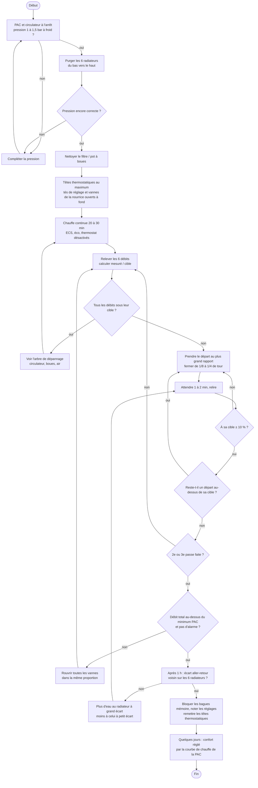
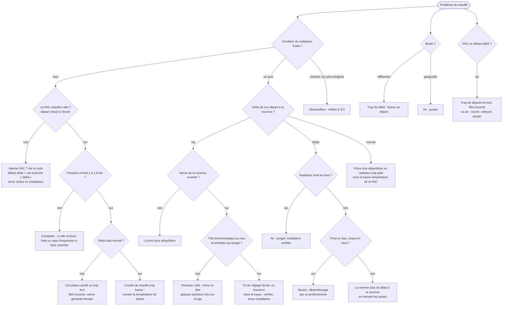

# Équilibrer son chauffage central à nourrice — guide pour non-spécialiste

> Rédigé le 2026-11-08 pour l'installation de la maison : **pompe à chaleur (PAC) air-eau**, une **nourrice**
> (collecteur) qui alimente **6 radiateurs** (≥ 1 400 W chacun), un **débitmètre-vanne de réglage par départ**.
> Les débitmètres électroniques du projet (`tasks/plans/debitmetres-chauffage.md`) afficheront les 6 débits.
> Les schémas `mermaid` s'affichent sur GitHub, ou dans VS Code avec une extension d'aperçu mermaid.

## En bref

1. **Préparer** : pression correcte, radiateurs purgés, filtre de la PAC propre.
2. **Tout ouvrir** : têtes thermostatiques au maximum (ou retirées), tés de réglage des radiateurs ouverts,
   vannes de la nourrice ouvertes.
3. **Calculer** le débit cible de chaque radiateur : on partage le débit de la PAC au prorata des puissances.
4. **Régler à la nourrice uniquement**, en commençant par le départ qui a le plus d'excès de débit, par petits
   gestes, en plusieurs passes. **Au moins une vanne reste ouverte à fond.**
5. **Vérifier** le débit total de la PAC (au-dessus de son minimum) puis l'écart de température de chaque radiateur.
6. **Noter et bloquer** les réglages, remettre les têtes thermostatiques, puis régler le confort par la courbe de
   chauffe (loi d'eau) de la PAC, **jamais** en refermant les vannes de la nourrice.

---

## 1. Comprendre son installation (5 minutes)

| Élément | Où | Rôle | À retenir |
|---|---|---|---|
| **PAC air-eau** | dehors + module intérieur | Chauffe l'eau ; son circulateur la fait tourner | Exige un **débit minimal** (sinon « défaut débit ») |
| **Nourrice / collecteur** | chaufferie | Répartit l'eau : **un départ et un retour par radiateur** (distribution « en pieuvre ») | C'est **le bon endroit pour équilibrer** : chaque vanne règle un seul radiateur |
| **Débitmètre-vanne de réglage** (sur chaque départ) | nourrice | Affiche le débit (L/min) et le règle | Souvent une **bague mémoire** pour retrouver le réglage |
| **Robinet thermostatique** (tête graduée 1 à 5) | entrée du radiateur | Régule la pièce en fermant quand il fait chaud | Ce n'est **pas** un organe d'équilibrage |
| **Té de réglage** (petit bouchon, souvent caché) | sortie du radiateur | Réglage fixe du débit | Avec une nourrice à vannes : **le laisser ouvert à fond** |
| **Purgeur** | haut du radiateur | Évacue l'air | À faire installation **arrêtée** |
| **Manomètre** | PAC ou chaufferie | Pression de l'eau | Valeur conseillée : voir § 3 |

**Pourquoi équilibrer ?** L'eau prend le chemin le plus facile : les radiateurs proches ou à tuyaux courts reçoivent
trop d'eau, les éloignés pas assez. Résultat : pièces froides, bruits, PAC qui cycle. Avec une nourrice, chaque
radiateur a son propre tuyau : il suffit de **freiner les départs trop gourmands** à la nourrice.

---

## 2. Données à relever avant de commencer

### 2.1 La PAC (notice ou écran de la PAC)

| Donnée | Valeur | Où la trouver |
|---|---|---|
| Puissance nominale (kW) | ……… | Plaque, notice |
| **Débit nominal** (L/h ou L/min) | ……… | Notice, « données hydrauliques » |
| **Débit minimal** (L/h ou L/min) | ……… | Notice (indispensable : sous ce débit, la PAC se met en défaut) |
| Écart départ-retour de conception (K) | ……… | Notice ; à défaut, lire départ et retour sur l'écran après 1 h de marche |
| Température de départ au plus froid (°C) | ……… | Réglage de la courbe de chauffe |
| Pression conseillée à froid (bar) | ……… | Notice |
| Débit affiché par la PAC (si elle l'affiche) | ……… | Menu « informations » ou « hydraulique » |

> **Attention, écart départ-retour (ΔT)** : les fabricants de vannes donnent **10 à 15 K** comme valeur typique
> d'une PAC (Danfoss), d'autres installations sont réglées à **5 K**. C'est la PAC qui fixe ce chiffre : **lisez-le
> sur votre PAC** (départ − retour, après une heure de chauffe) avant de calculer les débits.

### 2.1 bis Votre PAC : Daikin Altherma haute température

Ce que disent les manuels Daikin (extraits trouvés en ligne, **modèle exact à confirmer sur la plaque** : Altherma 3 H HT
`ETSH/ETSX…` ou ancienne génération haute température `ETBH/ETBX…`, `EKHBRD…`) :

| Donnée | Valeur relevée | Conséquence pour le réglage |
|---|---|---|
| **Débit minimal** | **12 L/min** (Altherma 3 H HT, mise en service) ; 20 L/min sur l'ancienne génération ETBH/ETBX16 | Sous ce débit : erreur de débit (code `7H` sur les Altherma 3). Ne jamais fermer plusieurs départs |
| **Régulation de la pompe** | La pompe **fait varier son débit pour tenir un écart départ-retour fixe** | Le débit total change avec la météo : on règle des **proportions**, pas des L/min (§ 4) |
| **Écart départ-retour (ΔT)** | Émetteur « radiateurs » : **ΔT fixe de 10 K** (8 K si le réglage installateur `[2-0C]` vaut 2) ; sinon réglable de 3 à 10 K | À lire dans les réglages installateur, ou départ − retour à l'écran |
| Température de départ | Jusqu'à 70 °C environ (haute température) | Avec de l'eau chaude, les radiateurs rendent près de leur puissance nominale |

**Bonne nouvelle pour les débitmètres électroniques** : si le débit total ne descend jamais sous 12 L/min et que la
répartition est proportionnelle, chaque radiateur reçoit **sa part de 12 L/min au moins**. Pour un radiateur de
1 400 W sur un total d'environ 10 kW, cela fait au moins 1,7 L/min, au-dessus du minimum du capteur (1 L/min). Seul un
robinet thermostatique qui ferme fait descendre un départ sous ce seuil.

**Pour le réglage**, l'idéal est que l'installateur passe la pompe en **vitesse fixe** le temps de l'équilibrage (réglage
installateur). Sinon, régler un jour froid, PAC en chauffe continue, et raisonner en proportions.

### 2.1 ter Lire les données de la PAC avec un ESP32 (recherche du 2026-11-08)

**Modèle probable, d'après la photo** : une colonne grise de trois modules empilés, soit la **première génération
Altherma HT** (2008-2018). Elle comprend un module intérieur **`EKHBRD011/014/016`** (`ADV1`/`ADY1`, ou `ADV17`/`ADY17`
pour la version « R HT »), un ballon d'eau chaude `EKHTS` posé dessus et un groupe extérieur `ERRQ`/`ERSQ`. **À
confirmer sur la plaque signalétique** du module intérieur. Attention : les valeurs du § 2.1 bis (12 L/min, `7H`,
`[2-0C]`) viennent des manuels de l'**Altherma 3 H HT**. Sur une EKHBRD, relire le débit minimal et le ΔT dans le
manuel de *ce* modèle.

| Voie | Branchement | EKHBRD : ce qu'on sait | Avec Tasmota | Avis |
|---|---|---|---|---|
| **Port série `X10A`** de la carte, projet [ESPAltherma](https://github.com/raomin/ESPAltherma) | ESP32 directement sur le connecteur 5 broches de la carte (masse commune obligatoire) | **Aucun fichier de définition EKHBRD** dans le projet : on y trouve les LT, les ECH2O et les Altherma 3 HT (`EPRA`/`ETSH`/`ETV16`), rien pour la 1re génération HT | Non : firmware Arduino à part, pas un module Tasmota | ❌ Non prouvé, et il faut ouvrir la PAC, sous tension, pour toucher sa carte |
| **Bus thermostat `P1/P2`**, projet [P1P2MQTT](https://github.com/Arnold-n/P1P2MQTT) / [P1P2Serial](https://github.com/arnold-n/P1P2Serial) | 2 fils en parallèle du thermostat d'ambiance, adaptateur de bus (MAX22088) | Les systèmes `EKH*` sont « très limités, lecture seule » ; un cas EKHBRD-ADV17 est [discuté](https://www.github.com/Arnold-n/P1P2Serial/issues/41) | Le pont tout fait (ESP8266, vendu monté) publie en MQTT : Tasmota ou Node-RED lit ce MQTT | 🔶 Possible en lecture, peu de données attendues ; jamais plus de 2 appareils sur le bus |
| **Passerelle Modbus RTD-W** (Realtime Control Systems) | Sur `P1/P2`, en esclave d'une commande BRC21 ; sortie RS485 Modbus | Sa [notice FR](https://res.cloudinary.com/sonepar-fr/raw/upload/s--ayUiJ1AJ--/v1/documents/121/RTD-W_Installation_Instructions_20670-1.07_FR.pdf) la présente pour les hydrobox **Altherma HT** ; un utilisateur EKHBRD-ADV17 l'emploie | Oui : un ESP32 + RS485 lit les registres en Berry, **comme la cuve et la carte 16 relais du garage** | ✅ La plus propre (produit commercial, registres documentés) ; liste des modèles et prix à vérifier |
| **Sans toucher à la PAC** | Sondes DS18B20 départ et retour + les 6 débitmètres du projet | Indépendant du modèle | Oui, dans le firmware existant | ✅ Donne la puissance par radiateur : P (W) ≈ 1,16 × Q (L/h) × ΔT (K) |

**En résumé** : sur une EKHBRD, il n'existe pas de branchement ESP32 direct sur la carte qui soit prouvé. Si l'on veut
les données de la PAC (températures, mode, erreurs), la voie sûre passe par le **bus P1/P2** : la passerelle **RTD-W**
lue en Modbus par un ESP32 Tasmota, ou le pont **P1P2MQTT** lu en MQTT. Dans tous les cas, ne rien brancher PAC sous
tension, et rester en **lecture seule**.

**La passerelle RTD-W en détail** (notice FR 20670-1.07.12, lue le 2026-11-08) :

- Compatible avec les « Altherma HT hydroboxes » (chauffage seul ou réversible) et toute unité qui accepte une commande
  BRC21. Sur le bus P1/P2, elle fonctionne en esclave (`SUB`) ; la commande de la PAC doit être en maître (`MAIN`). **À
  vérifier avec la commande de l'EKHBRD.** Elle compte comme une commande sur P1/P2.
- Alimentation 15-24 V continu, 120 mA (possible depuis le bornier `X9A` de l'unité intérieure).
- Modbus RTU esclave sur RS485 (bornes `DB+`/`DA-`/`GND`) : **9600 bauds, 8 bits, sans parité, 1 bit d'arrêt**, adresse
  0 à 63 par le commutateur `SW1`, base des registres 0. Fonctions 03, 04, 06 et 16, 10 registres au plus par lecture.
- Températures en entier signé × 100 (2150 = 21,50 °C ; au-delà de 32767, soustraire 65536). 32767 = donnée absente.

| Registre (lecture, fonction 04) | Donnée |
|---|---|
| `I0021` / `I0022` / `I0036` | Erreur du groupe (0/1), code d'erreur (ASCII), sous-code |
| `I0023` | Température moyenne de l'eau de départ du groupe |
| `I0071` / `I0072` | Circulateur en marche / compresseur en marche |
| `I0076` / `I0077` / `I0078` | Dégivrage, réchauffage ECS, stockage ECS en cours |
| `I0080` + `I0081` | Heures de marche du circulateur (mot haut + mot bas) |
| `I0123` / `I0131` | **Température de départ / de retour** de l'unité 01 (`Ixx..`, xx = 01 à 16) |
| `I0132` / `I0133` | Température du ballon ECS / température extérieure (unité 01) |

En écriture (`H0001` consigne de départ 25-80 °C, `H0008` source des commandes…), **ne rien écrire** : seule la lecture
nous intéresse. Intérêt pour ce projet : départ − retour de la PAC × somme des 6 débits = **puissance fournie par la
PAC**, sans toucher au circuit frigorifique.

### 2.2 Les 6 radiateurs (tableau à remplir)

| Départ | Pièce | Puissance nominale (W) | Distance à la nourrice (m) | Débit cible (L/min) | Débit à vannes ouvertes | Débit réglé | Bague / tours | T aller | T retour |
|---|---|---|---|---|---|---|---|---|---|
| 1 | | | | | | | | | |
| 2 | | | | | | | | | |
| 3 | | | | | | | | | |
| 4 | | | | | | | | | |
| 5 | | | | | | | | | |
| 6 | | | | | | | | | |
| **Total** | | **ΣP =** | | **= débit PAC** | | | | | |

**Outils** : clé de purge, chiffon et récipient, tournevis plat, thermomètre infrarouge ou thermomètre à pince
(10-20 €), carnet. Optionnel : les débitmètres électroniques du projet.

---

## 3. Préparation (installation à l'arrêt)

1. **Pression** : PAC et circulateur arrêtés, eau froide. Lire le manomètre. Repère courant pour une maison :
   **1 à 1,5 bar à froid** (la notice de la PAC prime). Trop bas → compléter par le robinet de remplissage.
2. **Purger** chaque radiateur, du plus bas au plus haut de la maison : ouvrir la vis jusqu'à ce que l'eau coule
   sans bulles, refermer. **Relire la pression** après les purges et compléter si besoin.
3. **Filtre / pot à boues** de la PAC : le nettoyer s'il y en a un (boues = débit faible et radiateurs froids en bas).
4. **Désactiver** temporairement l'eau chaude sanitaire, les modes éco, nuit ou vacances, et tout thermostat d'ambiance
   qui couperait la PAC : il faut **une chauffe continue** pendant le réglage.

---

## 4. Calculer le débit cible de chaque radiateur

Principe simple et suffisant pour une maison : **partager le débit de la PAC au prorata des puissances des
radiateurs**. Le rapport reste valable quelle que soit la température de l'eau, car tous les radiateurs perdent de la
puissance dans la même proportion quand l'eau est moins chaude.

```
Débit cible du radiateur i  =  Débit nominal de la PAC  ×  Puissance du radiateur i  /  Somme des puissances
```

**Exemple** (chiffres fictifs) : PAC à 20 L/min ; radiateurs 1 400, 1 400, 1 600, 1 800, 2 000, 2 200 W (ΣP = 10 400 W).

| Radiateur | Puissance | Part | Débit cible |
|---|---|---|---|
| 1 | 1 400 W | 13,5 % | 2,7 L/min |
| 2 | 1 400 W | 13,5 % | 2,7 L/min |
| 3 | 1 600 W | 15,4 % | 3,1 L/min |
| 4 | 1 800 W | 17,3 % | 3,5 L/min |
| 5 | 2 000 W | 19,2 % | 3,8 L/min |
| 6 | 2 200 W | 21,2 % | 4,2 L/min |

**Contrôle avec la formule de la chaleur** : débit (L/h) = puissance réellement fournie (W) / (1,16 × ΔT). Un
radiateur de 1 400 W (puissance donnée pour de l'eau à ~70 °C) ne rend qu'environ 500 à 650 W avec de l'eau à
45-50 °C : à ΔT 5 K, cela fait 1,4 à 1,9 L/min ; à ΔT 10 K, 0,7 à 0,9 L/min.

**Avec une pompe qui fait varier son débit (Daikin Altherma)** : retenir surtout la **part** de chaque radiateur
(colonne « Part »). Pendant le réglage, calculer à chaque relevé :

```
Part mesurée du départ i  =  débit du départ i  /  somme des 6 débits relevés au même moment
```

et l'amener sur sa part cible. Ainsi le réglage reste juste même si la pompe change de débit entre deux relevés.

**Cas particulier** : une pièce plus froide par nature (mur nord, grandes baies) peut recevoir un peu plus que sa
part ; une pièce sur-dimensionnée, un peu moins.

> **Débitmètres électroniques du projet** : le capteur YF-B2 n'est garanti qu'**au-dessus de 1 L/min**. Si votre PAC
> travaille avec un ΔT de 10 K, les plus petits radiateurs peuvent être sous ce seuil : à vérifier avant l'achat des
> 5 capteurs restants.

---

## 5. Méthode de réglage pas à pas

### Étape A — Tout ouvrir

- Têtes thermostatiques : **au maximum** (ou retirées, le corps de vanne reste ouvert).
- Tés de réglage des radiateurs : **ouverts à fond** (dévisser le bouchon, tourner la vis à fond vers « ouvert »,
  noter le nombre de tours si vous fermez quelque chose, ce n'est pas le cas ici).
- Vannes des **6 départs de la nourrice : ouvertes à fond**.
- PAC en chauffe, **20 à 30 minutes** pour que tout se stabilise.

### Étape B — Relever l'état de départ

- Noter le débit de chaque départ (colonne « débit à vannes ouvertes »).
- Calculer pour chacun le **rapport débit mesuré / débit cible** ; avec une pompe à débit variable (Altherma), le
  rapport **part mesurée / part cible** (§ 4).
- Si la PAC affiche son débit : la somme des 6 doit être proche.

### Étape C — Régler, du plus gourmand au moins gourmand

1. Prendre le départ dont le **rapport mesuré / cible est le plus grand** (souvent le radiateur le plus proche).
2. Le fermer **par petits gestes** (1/8 à 1/4 de tour), attendre **1 à 2 minutes**, relire.
3. S'arrêter quand il est à sa cible (± 10 %).
4. Passer au suivant dans l'ordre des rapports décroissants.
5. Le départ le **plus défavorisé** (rapport le plus petit) **reste ouvert à fond** : il ne se règle pas.
6. **Refaire 2 ou 3 passes** : freiner un départ envoie un peu plus d'eau aux autres.

> Si tous les débits restent **sous** leur cible alors que tout est ouvert : le circulateur ne pousse pas assez (vitesse
> à augmenter si la PAC le permet) ou il y a un problème (boues, air, filtre) → arbre de dépannage, § 7.

### Étape D — Vérifier la PAC

- Débit total ≥ **débit minimal** de la PAC (notice). Sinon, rouvrir toutes les vannes **dans la même proportion**.
- Aucune alarme « débit » ou « ΔT » sur la PAC.

### Étape E — Vérifier au toucher et au thermomètre (après 1 heure)

- Sur chaque radiateur : température **aller** (entrée) et **retour** (sortie), ou sur chaque départ et retour de la
  nourrice.
- Les écarts doivent être **voisins** d'un radiateur à l'autre (± 2 K). Un radiateur à écart beaucoup plus grand
  manque d'eau : lui redonner un peu de débit ; plus petit : en trop.

### Étape F — Fixer et remettre en service

- Serrer les **bagues mémoire** des vannes (si présentes) et **noter** les réglages dans le tableau du § 2.2.
- Remettre les têtes thermostatiques (position 3 ≈ 20 °C).
- Réactiver eau chaude, modes éco, thermostat.

### Étape G — Régler le confort sur quelques jours

- **Toutes les pièces trop froides ou trop chaudes** → modifier la **courbe de chauffe** (loi d'eau) de la PAC, pas
  les vannes.
- **Une seule pièce** trop chaude → baisser sa tête thermostatique ; trop froide → vérifier qu'elle atteint sa cible,
  puis lui donner un peu plus de débit.
- Refaire un contrôle rapide en début de chaque hiver.

### Ce qu'il ne faut pas faire

- **Fermer une vanne de la nourrice pour baisser la température d'une pièce** : c'est le rôle de la tête thermostatique.
- **Fermer plusieurs départs en même temps** : la PAC peut passer sous son débit minimal et se mettre en défaut.
- Régler par **temps doux avec la PAC qui s'arrête souvent** : les débits ne sont pas stables. Choisir un jour froid ou
  forcer une consigne haute pendant le réglage.
- Purger **en marche** : on aspire de l'air au lieu d'en chasser.

---

## 6. Logigramme du réglage (ordre conseillé)



---

## 7. Arbre de dépannage



---

## 8. Avec les débitmètres électroniques du projet

- Les 6 débits s'afficheront sur l'écran tactile (TFT 480×320) de la carte « Serveur Débits de PAC » et sur sa page web : **plus
  besoin de lire les petits débitmètres de la nourrice**, et la mesure tient compte des variations.
- **Avant de poser les capteurs**, relever le débit de la PAC : les 6 turbines ajoutent de la résistance, et le débit
  total ne doit pas passer sous le minimum de la PAC.
- Après la pose, **refaire l'étape C** : les capteurs ont pu modifier la répartition.
- La somme des 6 débits doit être proche du débit affiché par la PAC : c'est un contrôle d'étalonnage gratuit.
- Plus tard (amélioration prévue au plan) : sondes de température aller et retour par départ, pour calculer la
  puissance réellement fournie par chaque radiateur.

---

## 9. Petit glossaire

| Terme | Signification |
|---|---|
| **ΔT (delta T)** | Écart de température entre l'eau qui entre et l'eau qui sort (en kelvins, K = °C d'écart) |
| **Débit** | Quantité d'eau qui passe, en L/min ou L/h (1 L/min = 60 L/h) |
| **Courbe de chauffe / loi d'eau** | Réglage de la PAC : plus il fait froid dehors, plus l'eau envoyée est chaude |
| **Pointeau** | Petite tige du robinet thermostatique, poussée par la tête ; peut se coller l'été |
| **Désembouage** | Nettoyage des boues du circuit, par un professionnel |
| **Bague mémoire** | Butée qui garde la position d'une vanne quand on la ferme puis la rouvre |

---

## 10. Sources

- [Suissetec — fiche HEIZ203, équilibrage hydraulique](https://merkblatt.suissetec.ch/fr-CH/HEIZ203/file/HEIZ203.pdf)
- [Itap — notice du débitmètre de collecteur 471FL](https://www.itap.it/cat_files/pdf/471FL_2594_IST_fr.pdf)
- [Giacomini — collecteur R553M, réglage des débits](https://static.giacomini.com/fr.giacomini.com/catalog/technical_documentation/R553M.pdf)
- [Caleffi — documentation collecteurs](https://www.caleffi.com/sites/default/files/media/external-file/01346_FR.pdf)
- [Eduscol — TP mise en service et équilibrage](https://eduscol.education.fr/sti/sites/eduscol.education.fr.sti/files/ressources/pedagogiques/13734/13734-tp5-mise-en-service-equilibrage-2021.pdf)
- [Danfoss — guide d'équilibrage (ΔT typiques, calcul du débit)](https://assets.danfoss.com/documents/DOC131186404734/DOC131186404734.pdf)
- [tado — comment équilibrer ses radiateurs](https://www.tado.com/fr/blog/how-to-balance-radiators)
- [Heating Help — équilibrage d'un collecteur à débitmètres (forum)](https://forum.heatinghelp.com/discussion/203632/how-to-properly-balance-a-hot-water-radiator-system)
- [TotalEnergies — radiateur qui ne chauffe pas](https://www.totalenergies.fr/particuliers/parlons-energie/dossiers-energie/chauffage-et-climatisation/radiateur-qui-ne-chauffe-pas-quelles-causes-et-quelles-solutions)
- [Que Choisir — débloquer un robinet thermostatique](https://www.quechoisir.org/conseils-bricolage-comment-debloquer-un-robinet-thermostatique-n100728)
- [Manuel Daikin Altherma 3 H HT (ManualsLib) — débit minimal 12 L/min](https://www.manualslib.fr/manual/452290/Daikin-Altherma-3-H-Ht-Ech2Oetsh16P30D.html?page=33)
- [Manuel Daikin Altherma (ManualsHive) — ΔT de chauffage, réglage [2-0C]](https://manualshive.com/en/manual/daikin/altherma-3-r-f/501204?page=185)
- [OpenEnergyMonitor — régulation de la pompe d'une Altherma 3](https://community.openenergymonitor.org/t/daikin-altherma-3-pump-limitation/29714)
- [Futura-Sciences — débit et ΔT d'une Altherma 3 (forum)](https://forums.futura-sciences.com/habitat-bioclimatique-isolation-chauffage/943762-conso-debit-daikin-altherma-3-a.html)
- [Énergie-environnement.ch — ausculter les radiateurs](https://www.energie-environnement.ch/fichiers/info_pdf/ausculter_les_radiateurs.pdf)

Ce guide résume des sources publiques ; il ne remplace ni la notice de votre PAC ni un installateur. Toute
intervention sur la PAC elle-même (réglages installateur, fluide frigorigène, électricité) relève d'un professionnel.
