# Carte des modules Berry par carte

> Fichier GENERE par carte_modules_berry.py - ne pas editer a la main.
> Sortie deterministe (ni date, ni ordre de hachage) : regeneree sans changement de fond, elle ne
> donne aucun diff. La date de generation est celle du commit.

77 modules (56 dans `data/fs`, 21 propres a une carte), 16 cartes.

## Tableau

Legende : **S** solidifie dans l'env (`custom_berry_solidify`) - **I** importe par l'autoexec - **C** `compileModule` / `loadBerryFile` - **D** charge indirectement (importe par un module charge sur la carte) - **#** reference seulement commentee - **P** fichier propre a la carte - puis la garde d'activation evaluee sur le `_persist.json` de la carte : **ON** / **OFF** / **?** (non evaluable). Pas d'etat = pas de garde. Cellule vide = rien. **Bloc** : bloc(s) du manifeste (`blocs` de `modele_persist.json`) dont `fichiers` contient le module. **Cout** : `solidifie Ko / .bec Ko`, lus dans le bloc TAILLE DU BINOME du driver (genere par `mesure_binomes.py --ecrire`), vide sans bloc de taille.

| Module | Famille | Bloc | Cout | bureau<br>tasmota32-interrupteur-energie | bureau<br>tasmota32s3-ecran-debits-pac | bureau<br>tasmota32s3-serveur-debits-pac | cave<br>tasmota32-serveur-rly | cave<br>tasmota32s3-ecran | cave<br>tasmota32s3-serveur-rly | etage2<br>tasmota32s3-grenier | garage<br>tasmota32-portail-jardin-modbus | garage<br>tasmota32p4-serveur-modbus | garage<br>tasmota32s3-capteurs-cuve-modbus | garage<br>tasmota32s3-portail-jardin-modbus | garage<br>tasmota32s3-rideau-garage-modbus | garage<br>tasmota32s3-serveur-modbus | jardin<br>tasmota32-projecteur-barbecue | jardin<br>tasmota32-projecteur-led | rdc<br>tasmota32s3-grenier |
|---|---|---|---|---|---|---|---|---|---|---|---|---|---|---|---|---|---|---|---|
| `configDevices` | Socle |  | 9,8 / 11,8 | S C ON | S C ON | S C ON | S C ON | S C ON | S C ON | S C ON | S C ON | S C ON | S C ON | S C ON | S C ON | S C ON | S C ON | S C ON | S C ON |
| `configGlobal` | Socle |  | 7,1 / 11,4 | S I C ON | S I C ON | S I C ON | S I C ON | S I C ON | S I C ON | S I C ON | S I C ON | S I C ON | S I C ON | S I C ON | S I C ON | S I C ON | S I C ON | S I C ON | S I C ON |
| `configModules` | Socle |  | 2,7 / 3,8 | S C ON | S C ON | S C ON | S C ON | S C ON | S C ON | S C ON | S C ON | S C ON | S C ON | S C ON | S C ON | S C ON | S C ON | S C ON | S C ON |
| `controleGeneral` | Socle |  | 13,4 / 19,3 | S I | S I | S I | S I | S I | S I | S I | S I | S I | S I | S I | S I | S I | S I | S I | S I |
| `controleLedTemoin` | Socle |  | 2,4 / 3,0 | S | S I | S I | S I | S I | S I | S I | S | S I | S I | S I | S I | S I | S | S | S I |
| `controleWeb` | Socle |  | 6,4 / 9,7 | S I | S I | S I | S I | S I | S I | S I | S I | S I | S I | S I | S I | S I | S I | S I | S I |
| `diversFonctions` | Socle |  | 5,9 / 8,1 | S I C ON | S I C ON | S I C ON | S I C ON | S I C ON | S I C ON | S I C ON | S I C ON | S I C ON | S I C ON | S I C ON | S I C ON | S I C ON | S I C ON | S I C ON | S I C ON |
| `gestionFileFolder` | Socle |  | 6,0 / 8,4 | S I C ON | S I C ON | S I C ON | S I C ON | S I C ON | S I C ON | S I C ON | S I C ON | S I C ON | S I C ON | S I C ON | S I C ON | S I C ON | S I C ON | S I C ON | S I C ON |
| `globalFonctions` | Socle |  | 14,9 / 23,3 | S I C ON | S I C ON | S I C ON | S I C ON | S I C ON | S I C ON | S I C ON | S I C ON | S I C ON | S I C ON | S I C ON | S I C ON | S I C ON | S I C ON | S I C ON | S I C ON |
| `logFonctions` | Socle |  | 10,9 / 15,9 | S I C ON | S I C ON | S I C ON | S I C ON | S I C ON | S I C ON | S I C ON | S I C ON | S I C ON | S I C ON | S I C ON | S I C ON | S I C ON | S I C ON | S I C ON | S I C ON |
| `webFonctions` | Socle |  | 1,1 / 1,9 | S I C ON | S I C ON | S I C ON | S I C ON | S I C ON | S I C ON | S I C ON | S I C ON | S I C ON | S I C ON | S I C ON | S I C ON | S I C ON | S I C ON | S I C ON | S I C ON |
| `controleDiscovery` | Reseau | discovery | 2,0 / 2,9 | S I OFF | S | S I ON | S I OFF | S I ON | S I ON | S I ON | S I ON | S I ON | S I ON | S I ON | S I ON | S I ON | S I ON | S I ON | S I ON |
| `controleRangeExtender` | Reseau | rangeExtender | 1,3 / 1,9 | S | S I ON | S I ON | S I OFF | S I ON | S I ON | S I ON | S | S I ON | S | S | S | S I ON | S I ON | S I ON | S I ON |
| `controleTCP` | Reseau | tcp | 1,3 / 1,5 | S | S | S | S I OFF | S | S I OFF | S I OFF | S | S | S | S | S | S I ON | S | S | S I OFF |
| `controleUDP` | Reseau | udp | 1,7 / 2,2 | S | S I ON | S I ON | S I OFF | S I ON | S I ON | S I OFF | S | S I ON | S I ON | S I ON | S I ON | S I ON | S | S | S I ON |
| `discoveryFonctions` | Reseau | discovery | 15,1 / 21,0 | S C OFF | S D | S D | S C OFF | S D | S C ON | S D | S C ON | S C ON | S C ON | S C ON | S C ON | S C ON | S C ON | S C ON | S D |
| `rangeExtenderFonctions` | Reseau | rangeExtender | 5,7 / 8,9 | S D | S C ON | S D | S C OFF | S C ON | S C ON | S C ON | S D | S D | S D | S D | S D | S C ON | S C ON | S C ON | S C ON |
| `tcpFonctions` | Reseau | tcp | 3,2 / 4,6 | S D | S D | S D | S C OFF | S D | S C OFF | S C OFF | S D | S D | S D | S D | S D | S C ON | S D | S D | S C OFF |
| `udpFonctions` | Reseau | udp | 13,4 / 20,5 | S D | S C ON | S C ON | S C OFF | S C ON | S C ON | S C OFF | S D | S C ON | S C ON | S C ON | S C ON | S C ON | S D | S D | S C ON |
| `controleModbus` | ModBus | modbus | 3,2 / 5,1 |  | S I ON | S I ON |  | S I ON | S I ON |  | S | S I ON | S I ON | S I ON | S I ON | S I ON |  |  | S I ON |
| `modBus_Conn16channels` | ModBus | modbus | 7,4 / 11,2 |  | S I ON | S I ON |  | S I ON | S I ON |  | S | S I ON | S I ON | S I ON | S I ON | S I ON |  |  | S I ON |
| `modBus_TasmotaSlaveModBus` | ModBus | modbus | 27,4 / 36,9 |  | S I ON | S I ON |  | S I ON | S I ON |  | S | S I ON | S I ON | S I ON | S I ON | S I ON |  |  | S I ON |
| `modbusFonctions` | ModBus | modbus | 56,0 / 82,7 | D | S I | S I | D | S I | S I | D | S D | S I | S I | S I | S I | S I C ON | D | D | S I |
| `controleES8311` | Peripheriques | i2s | 15,6 / 11,0 |  |  |  |  |  |  |  |  | S I ON |  |  |  |  |  |  |  |
| `controleLeds` | Peripheriques | ruban, ledRGB | 1,6 / 2,1 |  |  |  |  |  | S I C OFF | S I C OFF | S |  | S I C ? | S I C OFF | S I C OFF | S I C OFF |  |  | S I C ? |
| `controleLoRaWan` | Peripheriques | lorawan | 0,8 / 1,0 |  |  |  |  |  |  | S I OFF |  |  |  |  |  | S I ON |  |  |  |
| `controleVoletRoulants` | Peripheriques | voletRoulants | 3,0 / 3,8 |  |  |  |  |  |  | S I ON |  | S I ON |  |  |  | S I OFF |  |  | S I ON |
| `i2c_ads1115` | Peripheriques | ads1115 | 4,9 / 6,6 |  | S I ON | S I ON |  | S I ON | S I ON |  | S | S I ON | S I ON | S I OFF | S I OFF | S I ON |  |  | S I ON |
| `i2c_mcp23017` | Peripheriques | modbus | 1,9 / 2,6 |  | S I ON | S I ON |  | S I ON | S I ON |  | S | S I ON | S I ON | S I OFF | S I OFF | S I ON |  |  | S I ON |
| `ledsFonctions` | Peripheriques | ruban, ledRGB | 14,2 / 19,3 | D | D | D | D | D | S D C OFF | S D C OFF | S D | D | S I C ON | S D C OFF | S D C OFF | S D C OFF | D | D | S C ON |
| `ledsPanelFonctions` | Peripheriques |  | 4,0 / 10,9 | S D | S D | S D | S D | S D | S D | S D | S D | S D | S D | S D | S D | S D | S D | S D | S D |
| `loRaWanFonctions` | Peripheriques | lorawan | 1,9 / 2,9 |  |  |  |  |  |  | S C OFF |  |  |  |  |  | S C ON |  |  |  |
| `vrFonctions` | Peripheriques | voletRoulants | 19,2 / 27,5 |  |  |  |  |  |  | S C ON |  | S D |  |  |  | S C OFF |  |  | S D |
| `vrPages` | Peripheriques | voletRoulants | 8,1 / 10,6 |  |  |  |  |  |  | S D |  | S D |  |  |  | D |  |  | S D |
| `vrReglage` | Peripheriques | voletRoulants | 6,9 / 10,0 |  |  |  |  |  |  | S D |  | S D |  |  |  | D |  |  | S D |
| `controleCommandesEcran` | Carte |  |  |  |  |  |  |  | P C ON |  |  |  |  |  |  |  |  |  |  |
| `controleCuve` | Carte |  |  |  |  |  |  |  |  |  |  |  | P C ON |  |  |  |  |  |  |
| `controleDebits` | Carte |  |  |  |  | P C ON |  |  |  |  |  |  |  |  |  |  |  |  |  |
| `controleEcranCave` | Carte |  |  |  |  |  |  | P C ON |  |  |  |  |  |  |  |  |  |  |  |
| `controleEcranDebits` | Carte |  |  |  | P C ON |  |  |  |  |  |  |  |  |  |  |  |  |  |  |
| `controleGarage` | Carte |  |  |  |  |  |  |  |  |  |  | P C ON |  |  |  | P C ON |  |  |  |
| `controleGrenier` | Carte |  |  |  |  |  |  |  |  | P C ON |  |  |  |  |  |  |  |  |  |
| `controleHumidite` | Carte |  |  |  |  |  | S P I ON |  | S P I ON |  |  |  |  |  |  |  |  |  |  |
| `controlePompeVideCave` | Carte |  |  |  |  |  | S P I ON |  | S P I ON |  |  |  |  |  |  |  |  |  |  |
| `controlePortail` | Carte |  |  |  |  |  |  |  |  |  | S P |  |  | S P I ON |  |  |  |  |  |
| `controleRideau` | Carte |  |  |  |  |  |  |  |  |  |  |  |  |  | S P I ON |  |  |  |  |
| `cuveFonctions` | Carte |  |  |  |  |  |  |  |  |  |  |  | P C ON |  |  |  |  |  |  |
| `debitsFonctions` | Carte |  |  |  |  | P C ON |  |  |  |  |  |  |  |  |  |  |  |  |  |
| `ecranCaveFonctions` | Carte |  |  |  |  |  |  | P C ON |  |  |  |  |  |  |  |  |  |  |  |
| `ecranCaveHaspmota` | Carte |  |  |  |  |  |  | P C ON |  |  |  |  |  |  |  |  |  |  |  |
| `ecranDebitsFonctions` | Carte |  |  |  | P C ON |  |  |  |  |  |  |  |  |  |  |  |  |  |  |
| `ecranHaspmota` | Carte |  |  |  | P C ON |  |  |  |  |  |  |  |  |  |  |  |  |  |  |
| `ecranLvgl` | Carte |  |  |  | P C ON |  |  |  |  |  |  |  |  |  |  |  |  |  |  |
| `equilibragePage` | Carte |  |  |  |  | P C ON |  |  |  |  |  |  |  |  |  |  |  |  |  |
| `garageFonctions` | Carte |  |  |  |  |  |  |  |  |  |  | P C ON |  |  |  | P C ON |  |  |  |
| `preinit` | Carte |  |  |  | P |  |  | P |  |  |  |  |  |  |  |  |  |  |  |
| `controleCoprocesseur` | Autres | coprocesseur | 7,7 / 10,7 |  |  |  |  |  |  |  |  | S I ON |  |  |  |  |  |  |  |
| `controleEcranSysteme` | Autres | ecranSysteme | non solid. / 1,1 |  | C ON |  |  |  |  |  |  |  |  |  |  |  |  |  |  |
| `controleEnergie` | Autres | energie | 2,4 / 3,1 | S I ON |  |  |  |  |  |  |  |  |  |  |  |  | S I ON | S I ON |  |
| `controleHue` | Autres | emulationHue | 3,9 / 5,0 |  |  |  |  |  | S I | S I |  | S I |  |  |  |  |  |  | S I |
| `controleMqttLiaison` | Autres | liaisonMqtt | 8,5 / 11,1 |  |  |  |  |  |  |  |  | S I ON |  |  |  |  |  |  |  |
| `controleVisuel` | Autres | visuel | 0,7 / 1,0 |  |  |  |  |  |  |  |  |  | S I |  |  |  |  |  |  |
| `cuvePageFonctions` | Autres | page_cuve | 1,7 / 2,4 |  |  |  |  |  |  |  |  | S D | S D |  |  |  |  |  |  |
| `demarrage` | Autres |  | 3,2 / 4,6 | S I | S I | S I | S I | S I | S I | S I | S I | S I | S I | S I | S I | S | S I | S I | S I |
| `ecranFonctions` | Autres | ecran | 5,4 / 7,1 |  | S D |  |  | S D |  |  |  |  |  |  |  |  |  |  |  |
| `ecranSysteme` | Autres | ecranSysteme | non solid. / 17,2 |  | C ON |  |  |  |  |  |  |  |  |  |  |  |  |  |  |
| `energieFonctions` | Autres | energie | 12,2 / 16,1 | S D |  |  |  |  |  |  |  |  |  |  |  |  | S D | S D |  |
| `fsMqtt` | Autres | fsMqtt | 6,2 / 7,6 | S | S I | S I | S I | S I | S I | S | S | S I | S I | S I | S I | S | S | S | S I |
| `graphiquesFonctions` | Autres | historique | 8,7 / 11,6 |  |  | S I |  |  | S I | S I |  | S I | S I | S I | S I | S I |  |  | S I |
| `historiqueFonctions` | Autres | historique | 12,6 / 16,2 |  |  | S I C ON |  |  | S I C ON | S I C ON |  | S I C ON | S I C ON | S I C ON | S I C ON | S I C ON |  |  | S I C ON |
| `historiqueSeries` | Autres | historique | 3,9 / 4,6 |  |  | S I |  |  | S I | S I |  | S I | S I | S I | S I | S I |  |  | S I |
| `hueFonctions` | Autres | emulationHue | 3,6 / 4,5 |  |  |  |  |  | S D | S D |  | S D |  |  |  |  |  |  | S D |
| `mqttLiaisonFonctions` | Autres | liaisonMqtt | 6,0 / 8,2 |  |  |  |  |  |  |  |  | S D |  |  |  |  |  |  |  |
| `pagesGraphiques` | Autres | pages_graphiques | 6,5 / 9,4 |  |  |  |  |  |  |  |  |  |  |  |  |  |  |  |  |
| `pagesGraphiquesValidation` | Autres | pages_graphiques | 10,4 / 12,9 |  |  | D |  |  | D | D |  | D | D | D | D | D |  |  | D |
| `qrcodePage` | Autres | qrcode | 2,3 / 3,3 | S I | S I | S I | S I | S I | S I | S I | S I | S I | S I | S I | S I |  | S I | S I | S I |
| `visuelFonctions` | Autres | visuel | 7,6 / 10,1 |  |  |  |  |  |  |  |  |  | S D |  |  |  |  |  |  |

Envs : `bureau/tasmota32-interrupteur-energie` = `tasmota32-bureau-interrupteur-energie` ; `bureau/tasmota32s3-ecran-debits-pac` = `tasmota32s3-bureau-ecran-debits-pac` ; `bureau/tasmota32s3-serveur-debits-pac` = `tasmota32s3-bureau-serveur-debits-pac` ; `cave/tasmota32-serveur-rly` = `tasmota32-cave-serveur-rly` ; `cave/tasmota32s3-ecran` = `tasmota32s3-cave-ecran` ; `cave/tasmota32s3-serveur-rly` = `tasmota32s3-cave-serveur-rly` ; `etage2/tasmota32s3-grenier` = `tasmota32s3-etage2-grenier` ; `garage/tasmota32-portail-jardin-modbus` = `tasmota32-garage-portail-jardin-modbus` ; `garage/tasmota32p4-serveur-modbus` = `tasmota32p4-garage-serveur-modbus` ; `garage/tasmota32s3-capteurs-cuve-modbus` = `tasmota32s3-garage-capteurs-cuve-modbus` ; `garage/tasmota32s3-portail-jardin-modbus` = `tasmota32s3-garage-portail-jardin-modbus` ; `garage/tasmota32s3-rideau-garage-modbus` = `tasmota32s3-garage-rideau-garage-modbus` ; `garage/tasmota32s3-serveur-modbus` = `tasmota32s3-garage-serveur-modbus` ; `jardin/tasmota32-projecteur-barbecue` = `tasmota32-jardin-projecteur-barbecue` ; `jardin/tasmota32-projecteur-led` = `tasmota32-jardin-projecteur-led` ; `rdc/tasmota32s3-grenier` = `tasmota32s3-rdc-grenier`

## Incoherences detectees

Constats factuels, sans jugement : un module peut etre volontairement dans cet etat.

- L'env `tasmota32-rdc-vr-porte` definit `custom_berry_solidify` mais son dossier `data/rdc/tasmota32-vr-porte` n'existe pas.
- `bureau/tasmota32-interrupteur-energie` : `controleLedTemoin` solidifie, jamais importe ni charge par l'autoexec.
- `bureau/tasmota32-interrupteur-energie` : `controleRangeExtender` solidifie, jamais importe ni charge par l'autoexec.
- `bureau/tasmota32-interrupteur-energie` : `controleTCP` solidifie, jamais importe ni charge par l'autoexec.
- `bureau/tasmota32-interrupteur-energie` : `controleUDP` solidifie, jamais importe ni charge par l'autoexec.
- `bureau/tasmota32-interrupteur-energie` : `fsMqtt` solidifie, jamais importe ni charge par l'autoexec.
- `bureau/tasmota32s3-ecran-debits-pac` : `controleDiscovery` solidifie, jamais importe ni charge par l'autoexec.
- `bureau/tasmota32s3-ecran-debits-pac` : `controleTCP` solidifie, jamais importe ni charge par l'autoexec.
- `bureau/tasmota32s3-ecran-debits-pac` : `preinit.be` est dans le dossier de la carte mais l'autoexec ne le charge pas.
- `bureau/tasmota32s3-serveur-debits-pac` : `controleTCP` solidifie, jamais importe ni charge par l'autoexec.
- `cave/tasmota32s3-ecran` : `controleTCP` solidifie, jamais importe ni charge par l'autoexec.
- `cave/tasmota32s3-ecran` : `preinit.be` est dans le dossier de la carte mais l'autoexec ne le charge pas.
- `etage2/tasmota32s3-grenier` : `fsMqtt` solidifie, jamais importe ni charge par l'autoexec.
- `garage/tasmota32-portail-jardin-modbus` : `controleLedTemoin` solidifie, jamais importe ni charge par l'autoexec.
- `garage/tasmota32-portail-jardin-modbus` : `controleRangeExtender` solidifie, jamais importe ni charge par l'autoexec.
- `garage/tasmota32-portail-jardin-modbus` : `controleTCP` solidifie, jamais importe ni charge par l'autoexec.
- `garage/tasmota32-portail-jardin-modbus` : `controleUDP` solidifie, jamais importe ni charge par l'autoexec.
- `garage/tasmota32-portail-jardin-modbus` : `controleModbus` solidifie, jamais importe ni charge par l'autoexec.
- `garage/tasmota32-portail-jardin-modbus` : `modBus_Conn16channels` solidifie, jamais importe ni charge par l'autoexec.
- `garage/tasmota32-portail-jardin-modbus` : `modBus_TasmotaSlaveModBus` solidifie, jamais importe ni charge par l'autoexec.
- `garage/tasmota32-portail-jardin-modbus` : `controleLeds` solidifie, jamais importe ni charge par l'autoexec.
- `garage/tasmota32-portail-jardin-modbus` : `i2c_ads1115` solidifie, jamais importe ni charge par l'autoexec.
- `garage/tasmota32-portail-jardin-modbus` : `i2c_mcp23017` solidifie, jamais importe ni charge par l'autoexec.
- `garage/tasmota32-portail-jardin-modbus` : `controlePortail` solidifie, jamais importe ni charge par l'autoexec.
- `garage/tasmota32-portail-jardin-modbus` : `controlePortail.be` est dans le dossier de la carte mais l'autoexec ne le charge pas.
- `garage/tasmota32-portail-jardin-modbus` : `fsMqtt` solidifie, jamais importe ni charge par l'autoexec.
- `garage/tasmota32p4-serveur-modbus` : `controleTCP` solidifie, jamais importe ni charge par l'autoexec.
- `garage/tasmota32s3-capteurs-cuve-modbus` : `controleRangeExtender` solidifie, jamais importe ni charge par l'autoexec.
- `garage/tasmota32s3-capteurs-cuve-modbus` : `controleTCP` solidifie, jamais importe ni charge par l'autoexec.
- `garage/tasmota32s3-portail-jardin-modbus` : `controleRangeExtender` solidifie, jamais importe ni charge par l'autoexec.
- `garage/tasmota32s3-portail-jardin-modbus` : `controleTCP` solidifie, jamais importe ni charge par l'autoexec.
- `garage/tasmota32s3-rideau-garage-modbus` : `controleRangeExtender` solidifie, jamais importe ni charge par l'autoexec.
- `garage/tasmota32s3-rideau-garage-modbus` : `controleTCP` solidifie, jamais importe ni charge par l'autoexec.
- `garage/tasmota32s3-serveur-modbus` : `demarrage` solidifie, jamais importe ni charge par l'autoexec.
- `garage/tasmota32s3-serveur-modbus` : `fsMqtt` solidifie, jamais importe ni charge par l'autoexec.
- `jardin/tasmota32-projecteur-barbecue` : `controleLedTemoin` solidifie, jamais importe ni charge par l'autoexec.
- `jardin/tasmota32-projecteur-barbecue` : `controleTCP` solidifie, jamais importe ni charge par l'autoexec.
- `jardin/tasmota32-projecteur-barbecue` : `controleUDP` solidifie, jamais importe ni charge par l'autoexec.
- `jardin/tasmota32-projecteur-barbecue` : `fsMqtt` solidifie, jamais importe ni charge par l'autoexec.
- `jardin/tasmota32-projecteur-led` : `controleLedTemoin` solidifie, jamais importe ni charge par l'autoexec.
- `jardin/tasmota32-projecteur-led` : `controleTCP` solidifie, jamais importe ni charge par l'autoexec.
- `jardin/tasmota32-projecteur-led` : `controleUDP` solidifie, jamais importe ni charge par l'autoexec.
- `jardin/tasmota32-projecteur-led` : `fsMqtt` solidifie, jamais importe ni charge par l'autoexec.
- `data/fs/pagesGraphiques.be` : reference par aucune carte.
- `data/fs/pagesGraphiquesValidation.be` : reference par aucune carte.
- `data/etage2/tasmota32s3-grenier/controleGrenier.be` : fichier vide.

### Informations (normal ou voulu, listees pour memoire)

- `bureau/tasmota32-interrupteur-energie` : `controleDiscovery` : import / chargement conditionne par l'autoexec, condition evaluee OFF (non execute).
- `bureau/tasmota32-interrupteur-energie` : `discoveryFonctions` : charge alors que sa garde vaut OFF.
- `bureau/tasmota32s3-ecran-debits-pac` : `controleEcranSysteme` charge depuis `data/fs` sans etre solidifie (copie sur le FS, compile au demarrage).
- `bureau/tasmota32s3-ecran-debits-pac` : `ecranSysteme` charge depuis `data/fs` sans etre solidifie (copie sur le FS, compile au demarrage).
- `cave/tasmota32-serveur-rly` : `controleDiscovery` : import / chargement conditionne par l'autoexec, condition evaluee OFF (non execute).
- `cave/tasmota32-serveur-rly` : `controleRangeExtender` : import / chargement conditionne par l'autoexec, condition evaluee OFF (non execute).
- `cave/tasmota32-serveur-rly` : `controleTCP` : import / chargement conditionne par l'autoexec, condition evaluee OFF (non execute).
- `cave/tasmota32-serveur-rly` : `controleUDP` : import / chargement conditionne par l'autoexec, condition evaluee OFF (non execute).
- `cave/tasmota32-serveur-rly` : `discoveryFonctions` : charge alors que sa garde vaut OFF.
- `cave/tasmota32-serveur-rly` : `rangeExtenderFonctions` : charge alors que sa garde vaut OFF.
- `cave/tasmota32-serveur-rly` : `tcpFonctions` : charge alors que sa garde vaut OFF.
- `cave/tasmota32-serveur-rly` : `udpFonctions` : charge alors que sa garde vaut OFF.
- `cave/tasmota32s3-serveur-rly` : `controleTCP` : import / chargement conditionne par l'autoexec, condition evaluee OFF (non execute).
- `cave/tasmota32s3-serveur-rly` : `tcpFonctions` : charge alors que sa garde vaut OFF.
- `cave/tasmota32s3-serveur-rly` : `controleLeds` : import / chargement conditionne par l'autoexec, condition evaluee OFF (non execute).
- `cave/tasmota32s3-serveur-rly` : `ledsFonctions` : charge alors que sa garde vaut OFF.
- `etage2/tasmota32s3-grenier` : `controleTCP` : import / chargement conditionne par l'autoexec, condition evaluee OFF (non execute).
- `etage2/tasmota32s3-grenier` : `controleUDP` : import / chargement conditionne par l'autoexec, condition evaluee OFF (non execute).
- `etage2/tasmota32s3-grenier` : `tcpFonctions` : charge alors que sa garde vaut OFF.
- `etage2/tasmota32s3-grenier` : `udpFonctions` : charge alors que sa garde vaut OFF.
- `etage2/tasmota32s3-grenier` : `controleLeds` : import / chargement conditionne par l'autoexec, condition evaluee OFF (non execute).
- `etage2/tasmota32s3-grenier` : `controleLoRaWan` : import / chargement conditionne par l'autoexec, condition evaluee OFF (non execute).
- `etage2/tasmota32s3-grenier` : `ledsFonctions` : charge alors que sa garde vaut OFF.
- `etage2/tasmota32s3-grenier` : `loRaWanFonctions` : charge alors que sa garde vaut OFF.
- `garage/tasmota32s3-portail-jardin-modbus` : `controleLeds` : import / chargement conditionne par l'autoexec, condition evaluee OFF (non execute).
- `garage/tasmota32s3-portail-jardin-modbus` : `i2c_ads1115` : charge alors que sa garde vaut OFF.
- `garage/tasmota32s3-portail-jardin-modbus` : `i2c_mcp23017` : charge alors que sa garde vaut OFF.
- `garage/tasmota32s3-portail-jardin-modbus` : `ledsFonctions` : charge alors que sa garde vaut OFF.
- `garage/tasmota32s3-rideau-garage-modbus` : `controleLeds` : import / chargement conditionne par l'autoexec, condition evaluee OFF (non execute).
- `garage/tasmota32s3-rideau-garage-modbus` : `i2c_ads1115` : charge alors que sa garde vaut OFF.
- `garage/tasmota32s3-rideau-garage-modbus` : `i2c_mcp23017` : charge alors que sa garde vaut OFF.
- `garage/tasmota32s3-rideau-garage-modbus` : `ledsFonctions` : charge alors que sa garde vaut OFF.
- `garage/tasmota32s3-serveur-modbus` : `controleLeds` : import / chargement conditionne par l'autoexec, condition evaluee OFF (non execute).
- `garage/tasmota32s3-serveur-modbus` : `controleVoletRoulants` : charge alors que sa garde vaut OFF.
- `garage/tasmota32s3-serveur-modbus` : `ledsFonctions` : charge alors que sa garde vaut OFF.
- `garage/tasmota32s3-serveur-modbus` : `vrFonctions` : charge alors que sa garde vaut OFF.
- `rdc/tasmota32s3-grenier` : `controleTCP` : import / chargement conditionne par l'autoexec, condition evaluee OFF (non execute).
- `rdc/tasmota32s3-grenier` : `tcpFonctions` : charge alors que sa garde vaut OFF.

## Diagrammes

Un diagramme par carte (tout dans un seul serait illisible). Modules **charges** par l'autoexec (import / compileModule / loadBerryFile non commentes). Fleche pleine = garde ON ou sans garde ; pointillee = garde OFF ou non evaluable (?).

### bureau/tasmota32-interrupteur-energie

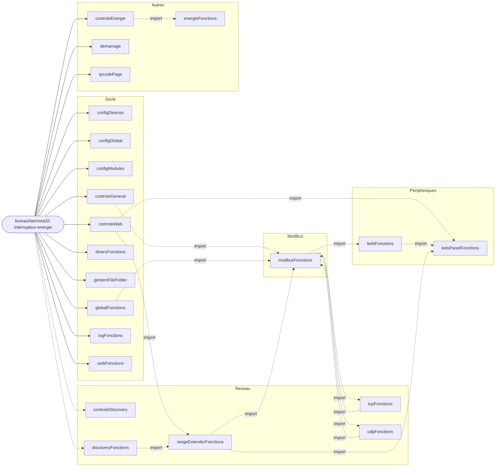

### bureau/tasmota32s3-ecran-debits-pac

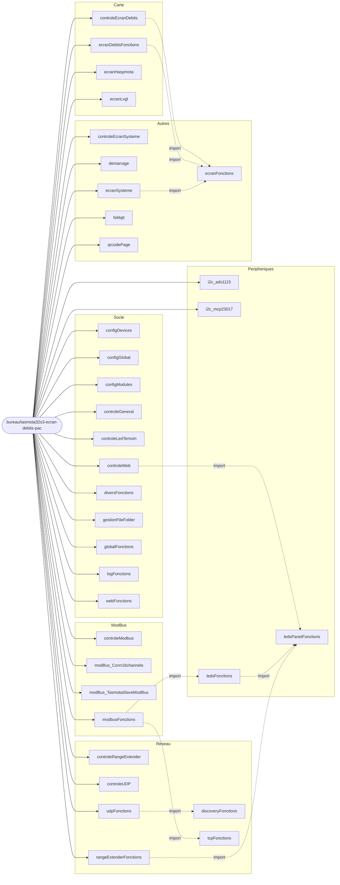

### bureau/tasmota32s3-serveur-debits-pac

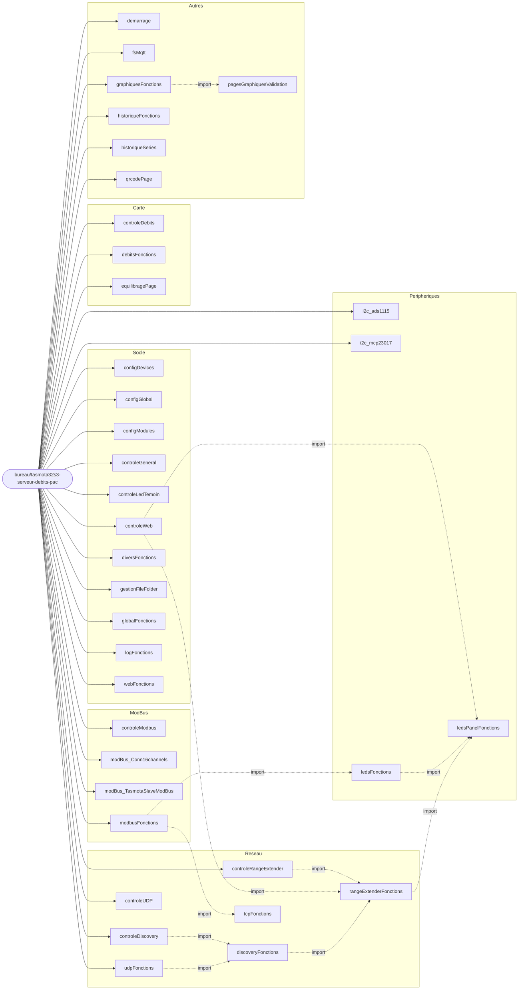

### cave/tasmota32-serveur-rly

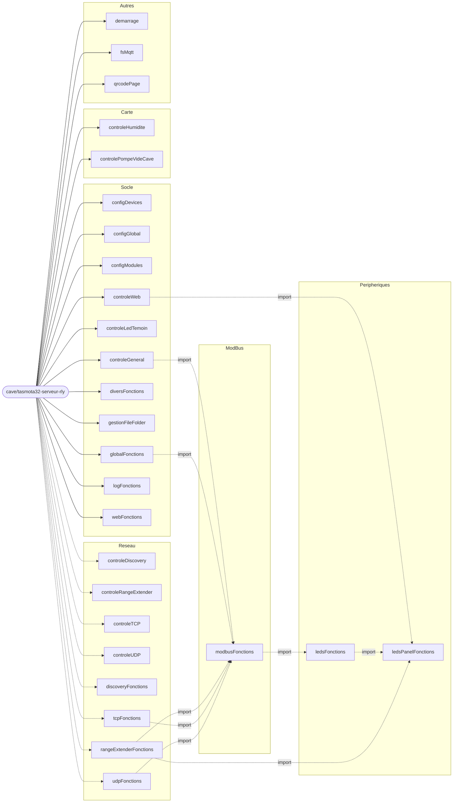

### cave/tasmota32s3-ecran

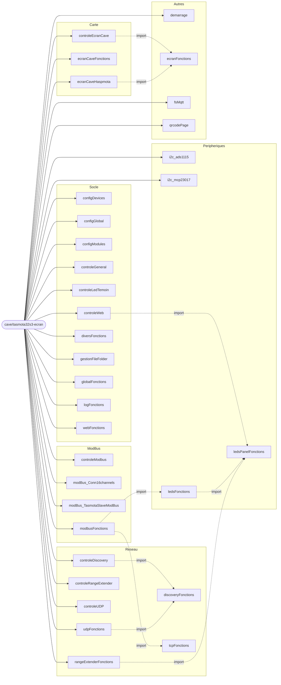

### cave/tasmota32s3-serveur-rly

```mermaid
flowchart LR
    CARTE(["cave/tasmota32s3-serveur-rly"])
    subgraph g_Socle["Socle"]
        m_configDevices["configDevices"]
        m_configGlobal["configGlobal"]
        m_configModules["configModules"]
        m_controleGeneral["controleGeneral"]
        m_controleLedTemoin["controleLedTemoin"]
        m_controleWeb["controleWeb"]
        m_diversFonctions["diversFonctions"]
        m_gestionFileFolder["gestionFileFolder"]
        m_globalFonctions["globalFonctions"]
        m_logFonctions["logFonctions"]
        m_webFonctions["webFonctions"]
    end
    subgraph g_Reseau["Reseau"]
        m_controleDiscovery["controleDiscovery"]
        m_controleRangeExtender["controleRangeExtender"]
        m_controleTCP["controleTCP"]
        m_controleUDP["controleUDP"]
        m_discoveryFonctions["discoveryFonctions"]
        m_rangeExtenderFonctions["rangeExtenderFonctions"]
        m_tcpFonctions["tcpFonctions"]
        m_udpFonctions["udpFonctions"]
    end
    subgraph g_ModBus["ModBus"]
        m_controleModbus["controleModbus"]
        m_modBus_Conn16channels["modBus_Conn16channels"]
        m_modBus_TasmotaSlaveModBus["modBus_TasmotaSlaveModBus"]
        m_modbusFonctions["modbusFonctions"]
    end
    subgraph g_Peripheriques["Peripheriques"]
        m_controleLeds["controleLeds"]
        m_i2c_ads1115["i2c_ads1115"]
        m_i2c_mcp23017["i2c_mcp23017"]
        m_ledsFonctions["ledsFonctions"]
        m_ledsPanelFonctions["ledsPanelFonctions"]
    end
    subgraph g_Carte["Carte"]
        m_controleCommandesEcran["controleCommandesEcran"]
        m_controleHumidite["controleHumidite"]
        m_controlePompeVideCave["controlePompeVideCave"]
    end
    subgraph g_Autres["Autres"]
        m_controleHue["controleHue"]
        m_demarrage["demarrage"]
        m_fsMqtt["fsMqtt"]
        m_graphiquesFonctions["graphiquesFonctions"]
        m_historiqueFonctions["historiqueFonctions"]
        m_historiqueSeries["historiqueSeries"]
        m_hueFonctions["hueFonctions"]
        m_pagesGraphiquesValidation["pagesGraphiquesValidation"]
        m_qrcodePage["qrcodePage"]
    end
    CARTE --> m_configDevices
    CARTE --> m_configGlobal
    CARTE --> m_configModules
    CARTE --> m_controleGeneral
    CARTE --> m_controleLedTemoin
    CARTE --> m_controleWeb
    CARTE --> m_diversFonctions
    CARTE --> m_gestionFileFolder
    CARTE --> m_globalFonctions
    CARTE --> m_logFonctions
    CARTE --> m_webFonctions
    CARTE --> m_controleDiscovery
    CARTE --> m_controleRangeExtender
    CARTE -.-> m_controleTCP
    CARTE --> m_controleUDP
    CARTE --> m_discoveryFonctions
    CARTE --> m_rangeExtenderFonctions
    CARTE -.-> m_tcpFonctions
    CARTE --> m_udpFonctions
    CARTE --> m_controleModbus
    CARTE --> m_modBus_Conn16channels
    CARTE --> m_modBus_TasmotaSlaveModBus
    CARTE --> m_modbusFonctions
    CARTE -.-> m_controleLeds
    CARTE --> m_i2c_ads1115
    CARTE --> m_i2c_mcp23017
    m_modbusFonctions -.->|import| m_ledsFonctions
    m_controleWeb -.->|import| m_ledsPanelFonctions
    m_ledsFonctions -.->|import| m_ledsPanelFonctions
    m_rangeExtenderFonctions -.->|import| m_ledsPanelFonctions
    CARTE --> m_controleCommandesEcran
    CARTE --> m_controleHumidite
    CARTE --> m_controlePompeVideCave
    CARTE --> m_controleHue
    CARTE --> m_demarrage
    CARTE --> m_fsMqtt
    CARTE --> m_graphiquesFonctions
    CARTE --> m_historiqueFonctions
    CARTE --> m_historiqueSeries
    m_controleHue -.->|import| m_hueFonctions
    m_graphiquesFonctions -.->|import| m_pagesGraphiquesValidation
    CARTE --> m_qrcodePage
```

### etage2/tasmota32s3-grenier

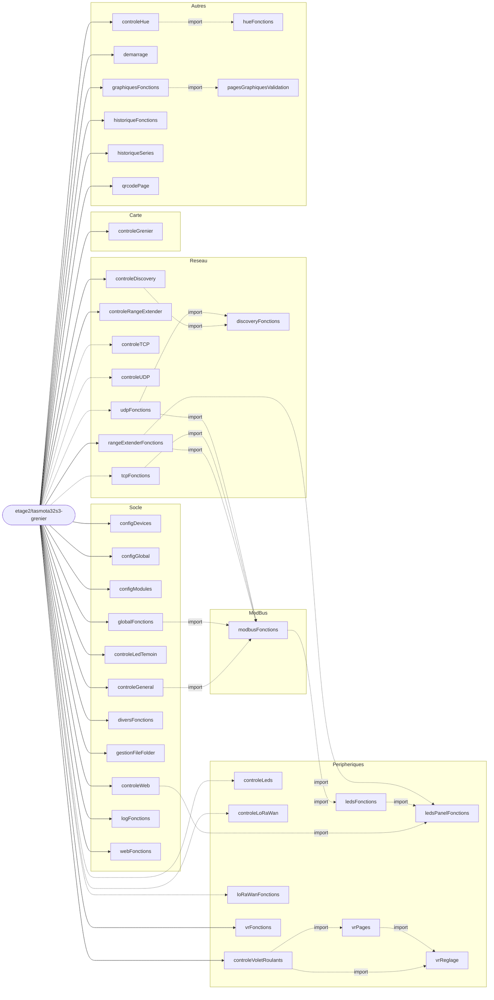

### garage/tasmota32-portail-jardin-modbus

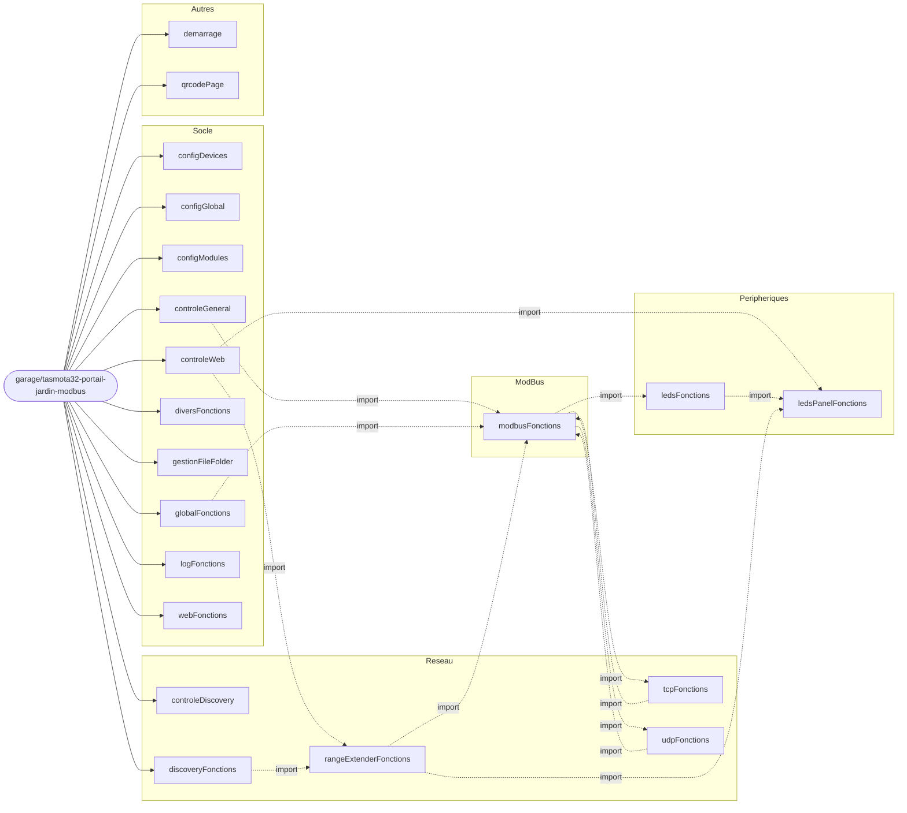

### garage/tasmota32p4-serveur-modbus

```mermaid
flowchart LR
    CARTE(["garage/tasmota32p4-serveur-modbus"])
    subgraph g_Socle["Socle"]
        m_configDevices["configDevices"]
        m_configGlobal["configGlobal"]
        m_configModules["configModules"]
        m_controleGeneral["controleGeneral"]
        m_controleLedTemoin["controleLedTemoin"]
        m_controleWeb["controleWeb"]
        m_diversFonctions["diversFonctions"]
        m_gestionFileFolder["gestionFileFolder"]
        m_globalFonctions["globalFonctions"]
        m_logFonctions["logFonctions"]
        m_webFonctions["webFonctions"]
    end
    subgraph g_Reseau["Reseau"]
        m_controleDiscovery["controleDiscovery"]
        m_controleRangeExtender["controleRangeExtender"]
        m_controleUDP["controleUDP"]
        m_discoveryFonctions["discoveryFonctions"]
        m_rangeExtenderFonctions["rangeExtenderFonctions"]
        m_tcpFonctions["tcpFonctions"]
        m_udpFonctions["udpFonctions"]
    end
    subgraph g_ModBus["ModBus"]
        m_controleModbus["controleModbus"]
        m_modBus_Conn16channels["modBus_Conn16channels"]
        m_modBus_TasmotaSlaveModBus["modBus_TasmotaSlaveModBus"]
        m_modbusFonctions["modbusFonctions"]
    end
    subgraph g_Peripheriques["Peripheriques"]
        m_controleES8311["controleES8311"]
        m_controleVoletRoulants["controleVoletRoulants"]
        m_i2c_ads1115["i2c_ads1115"]
        m_i2c_mcp23017["i2c_mcp23017"]
        m_ledsFonctions["ledsFonctions"]
        m_ledsPanelFonctions["ledsPanelFonctions"]
        m_vrFonctions["vrFonctions"]
        m_vrPages["vrPages"]
        m_vrReglage["vrReglage"]
    end
    subgraph g_Carte["Carte"]
        m_controleGarage["controleGarage"]
        m_garageFonctions["garageFonctions"]
    end
    subgraph g_Autres["Autres"]
        m_controleCoprocesseur["controleCoprocesseur"]
        m_controleHue["controleHue"]
        m_controleMqttLiaison["controleMqttLiaison"]
        m_cuvePageFonctions["cuvePageFonctions"]
        m_demarrage["demarrage"]
        m_fsMqtt["fsMqtt"]
        m_graphiquesFonctions["graphiquesFonctions"]
        m_historiqueFonctions["historiqueFonctions"]
        m_historiqueSeries["historiqueSeries"]
        m_hueFonctions["hueFonctions"]
        m_mqttLiaisonFonctions["mqttLiaisonFonctions"]
        m_pagesGraphiquesValidation["pagesGraphiquesValidation"]
        m_qrcodePage["qrcodePage"]
    end
    CARTE --> m_configDevices
    CARTE --> m_configGlobal
    CARTE --> m_configModules
    CARTE --> m_controleGeneral
    CARTE --> m_controleLedTemoin
    CARTE --> m_controleWeb
    CARTE --> m_diversFonctions
    CARTE --> m_gestionFileFolder
    CARTE --> m_globalFonctions
    CARTE --> m_logFonctions
    CARTE --> m_webFonctions
    CARTE --> m_controleDiscovery
    CARTE --> m_controleRangeExtender
    CARTE --> m_controleUDP
    CARTE --> m_discoveryFonctions
    m_controleRangeExtender -.->|import| m_rangeExtenderFonctions
    m_controleWeb -.->|import| m_rangeExtenderFonctions
    m_discoveryFonctions -.->|import| m_rangeExtenderFonctions
    m_modbusFonctions -.->|import| m_tcpFonctions
    CARTE --> m_udpFonctions
    CARTE --> m_controleModbus
    CARTE --> m_modBus_Conn16channels
    CARTE --> m_modBus_TasmotaSlaveModBus
    CARTE --> m_modbusFonctions
    CARTE --> m_controleES8311
    CARTE --> m_controleVoletRoulants
    CARTE --> m_i2c_ads1115
    CARTE --> m_i2c_mcp23017
    m_modbusFonctions -.->|import| m_ledsFonctions
    m_controleWeb -.->|import| m_ledsPanelFonctions
    m_ledsFonctions -.->|import| m_ledsPanelFonctions
    m_rangeExtenderFonctions -.->|import| m_ledsPanelFonctions
    m_controleVoletRoulants -.->|import| m_vrFonctions
    m_vrPages -.->|import| m_vrFonctions
    m_vrReglage -.->|import| m_vrFonctions
    m_controleVoletRoulants -.->|import| m_vrPages
    m_controleVoletRoulants -.->|import| m_vrReglage
    m_vrPages -.->|import| m_vrReglage
    CARTE --> m_controleGarage
    CARTE --> m_garageFonctions
    CARTE --> m_controleCoprocesseur
    CARTE --> m_controleHue
    CARTE --> m_controleMqttLiaison
    m_controleGarage -.->|import| m_cuvePageFonctions
    CARTE --> m_demarrage
    CARTE --> m_fsMqtt
    CARTE --> m_graphiquesFonctions
    CARTE --> m_historiqueFonctions
    CARTE --> m_historiqueSeries
    m_controleHue -.->|import| m_hueFonctions
    m_controleMqttLiaison -.->|import| m_mqttLiaisonFonctions
    m_graphiquesFonctions -.->|import| m_pagesGraphiquesValidation
    CARTE --> m_qrcodePage
```

### garage/tasmota32s3-capteurs-cuve-modbus

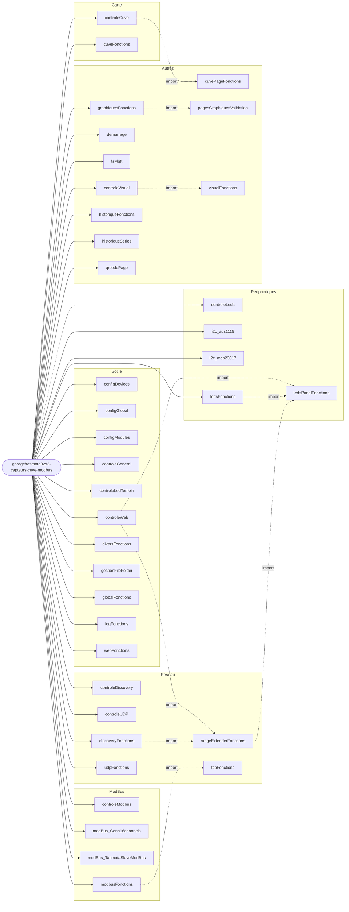

### garage/tasmota32s3-portail-jardin-modbus


### garage/tasmota32s3-rideau-garage-modbus

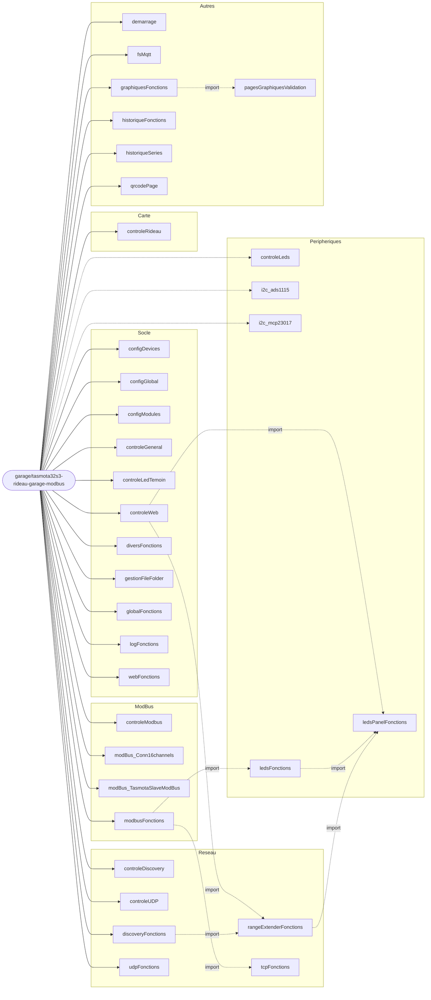

### garage/tasmota32s3-serveur-modbus

```mermaid
flowchart LR
    CARTE(["garage/tasmota32s3-serveur-modbus"])
    subgraph g_Socle["Socle"]
        m_configDevices["configDevices"]
        m_configGlobal["configGlobal"]
        m_configModules["configModules"]
        m_controleGeneral["controleGeneral"]
        m_controleLedTemoin["controleLedTemoin"]
        m_controleWeb["controleWeb"]
        m_diversFonctions["diversFonctions"]
        m_gestionFileFolder["gestionFileFolder"]
        m_globalFonctions["globalFonctions"]
        m_logFonctions["logFonctions"]
        m_webFonctions["webFonctions"]
    end
    subgraph g_Reseau["Reseau"]
        m_controleDiscovery["controleDiscovery"]
        m_controleRangeExtender["controleRangeExtender"]
        m_controleTCP["controleTCP"]
        m_controleUDP["controleUDP"]
        m_discoveryFonctions["discoveryFonctions"]
        m_rangeExtenderFonctions["rangeExtenderFonctions"]
        m_tcpFonctions["tcpFonctions"]
        m_udpFonctions["udpFonctions"]
    end
    subgraph g_ModBus["ModBus"]
        m_controleModbus["controleModbus"]
        m_modBus_Conn16channels["modBus_Conn16channels"]
        m_modBus_TasmotaSlaveModBus["modBus_TasmotaSlaveModBus"]
        m_modbusFonctions["modbusFonctions"]
    end
    subgraph g_Peripheriques["Peripheriques"]
        m_controleLeds["controleLeds"]
        m_controleLoRaWan["controleLoRaWan"]
        m_controleVoletRoulants["controleVoletRoulants"]
        m_i2c_ads1115["i2c_ads1115"]
        m_i2c_mcp23017["i2c_mcp23017"]
        m_ledsFonctions["ledsFonctions"]
        m_ledsPanelFonctions["ledsPanelFonctions"]
        m_loRaWanFonctions["loRaWanFonctions"]
        m_vrFonctions["vrFonctions"]
        m_vrPages["vrPages"]
        m_vrReglage["vrReglage"]
    end
    subgraph g_Carte["Carte"]
        m_controleGarage["controleGarage"]
        m_garageFonctions["garageFonctions"]
    end
    subgraph g_Autres["Autres"]
        m_graphiquesFonctions["graphiquesFonctions"]
        m_historiqueFonctions["historiqueFonctions"]
        m_historiqueSeries["historiqueSeries"]
        m_pagesGraphiquesValidation["pagesGraphiquesValidation"]
    end
    CARTE --> m_configDevices
    CARTE --> m_configGlobal
    CARTE --> m_configModules
    CARTE --> m_controleGeneral
    CARTE --> m_controleLedTemoin
    CARTE --> m_controleWeb
    CARTE --> m_diversFonctions
    CARTE --> m_gestionFileFolder
    CARTE --> m_globalFonctions
    CARTE --> m_logFonctions
    CARTE --> m_webFonctions
    CARTE --> m_controleDiscovery
    CARTE --> m_controleRangeExtender
    CARTE --> m_controleTCP
    CARTE --> m_controleUDP
    CARTE --> m_discoveryFonctions
    CARTE --> m_rangeExtenderFonctions
    CARTE --> m_tcpFonctions
    CARTE --> m_udpFonctions
    CARTE --> m_controleModbus
    CARTE --> m_modBus_Conn16channels
    CARTE --> m_modBus_TasmotaSlaveModBus
    CARTE --> m_modbusFonctions
    CARTE -.-> m_controleLeds
    CARTE --> m_controleLoRaWan
    CARTE -.-> m_controleVoletRoulants
    CARTE --> m_i2c_ads1115
    CARTE --> m_i2c_mcp23017
    m_modbusFonctions -.->|import| m_ledsFonctions
    m_controleWeb -.->|import| m_ledsPanelFonctions
    m_ledsFonctions -.->|import| m_ledsPanelFonctions
    m_rangeExtenderFonctions -.->|import| m_ledsPanelFonctions
    CARTE --> m_loRaWanFonctions
    CARTE -.-> m_vrFonctions
    m_controleVoletRoulants -.->|import| m_vrPages
    m_controleVoletRoulants -.->|import| m_vrReglage
    m_vrPages -.->|import| m_vrReglage
    CARTE --> m_controleGarage
    CARTE --> m_garageFonctions
    CARTE --> m_graphiquesFonctions
    CARTE --> m_historiqueFonctions
    CARTE --> m_historiqueSeries
    m_graphiquesFonctions -.->|import| m_pagesGraphiquesValidation
```

### jardin/tasmota32-projecteur-barbecue

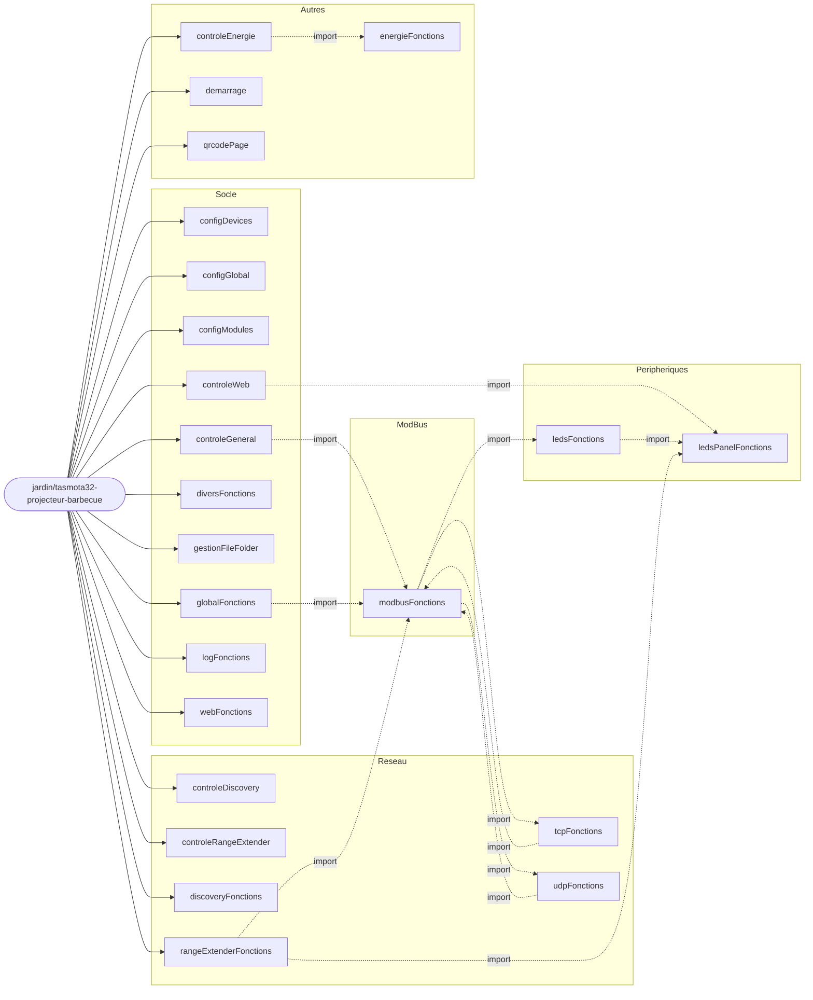

### jardin/tasmota32-projecteur-led

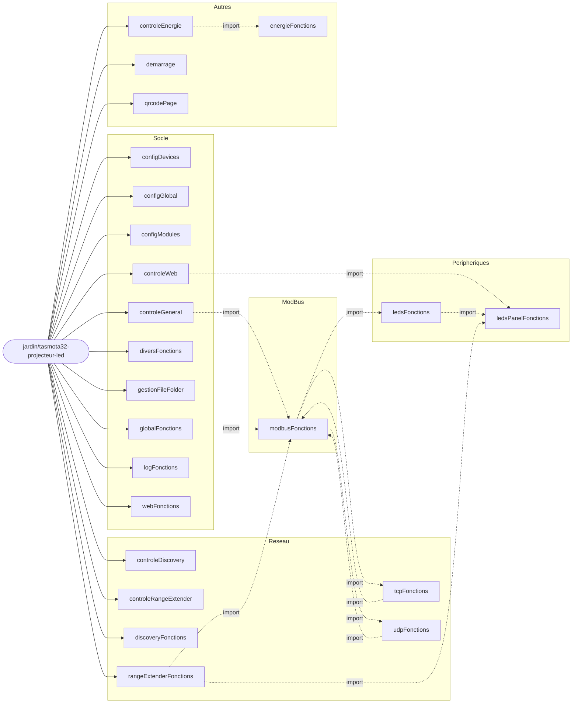

### rdc/tasmota32s3-grenier

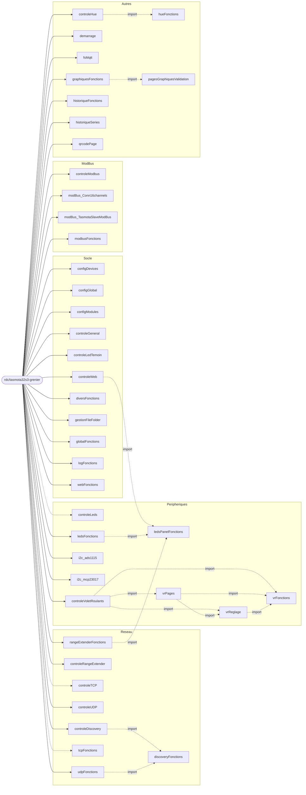

## Comment regenerer

```
python outils_docs/scripts_python/berry/carte_modules_berry.py
```

Lecture seule : aucun build, aucune ecriture sous `data/`. La config PlatformIO est lue par l'API `ProjectConfig` dans le Python de PlatformIO (`~/.platformio/penv`).
